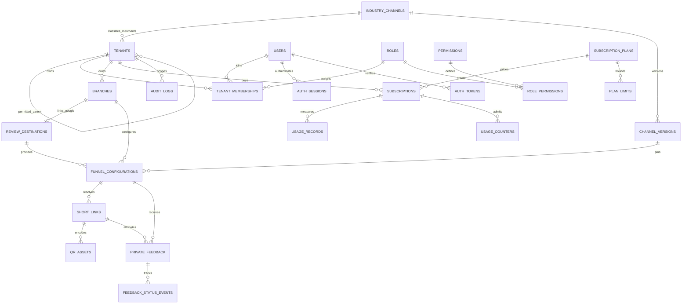
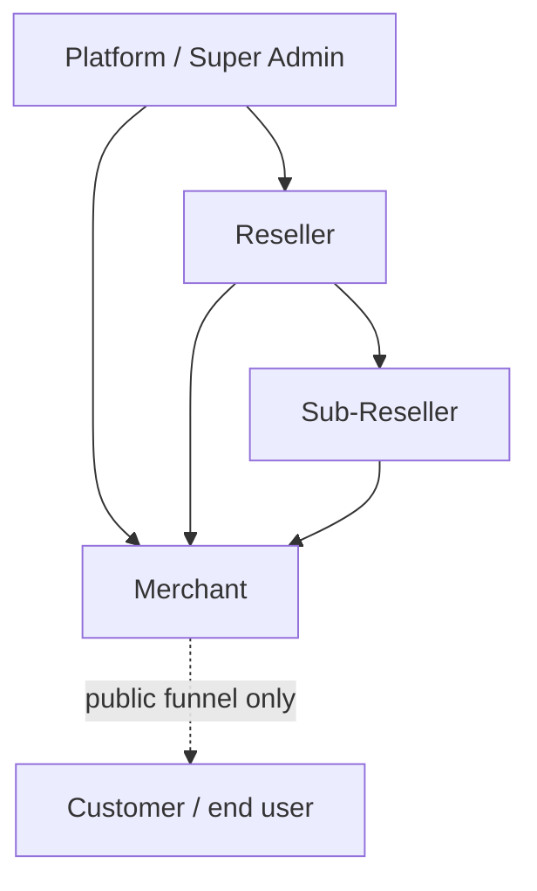

# MagicReview AI — Phase 1 database architecture proposal

Task 06 update: tenant/account management and invitation APIs are implemented
locally using the existing schema; no new migration or weakened constraint.
See tenants-api.md / tenants-security-report.md. Active managers can inspect
suspended descendant accounts for restoration while authentication/business
access through suspended ancestry remains denied. Production remains untouched.

Task 05 update: authentication and authorization services/routes now use this
schema; additive version 000063 stores the session authentication-version
snapshot. No earlier migration was edited. See auth-api.md and
auth-security-report.md for actual controls, tests and unimplemented MFA.

Status: Phase 1 schema implemented and locally verified in Task 04, 2026-11-04.
Production rollout remains unapproved and unperformed. API implementation status
is updated in the task notes above; the Task 04 schema audit below is historical.

Task 04 implements 23 business tables, 35 protective/validation triggers and four
catalog/role seed statements, using 62 new ordered migration files with matching
verification SQL. The original 000000 ledger migration is unchanged. All were
tested on a fresh disposable MariaDB 11.8.9 instance, not Hostinger production.
See [schema-implementation-report.md](schema-implementation-report.md) for the
complete file inventory, dependencies, tests and remaining rollout gates.
The source SQL and migration guide are authoritative for implemented details;
the initial audit below records the pre-schema backend state.

Task 03 update: only local MariaDB migration infrastructure and its tracking
table have now been implemented; no business schema exists from this proposal.
User reports Hostinger MariaDB 11.8.9/InnoDB/utf8mb4_unicode_ci and transaction/
savepoint support. Separate restricted identities remain unverified. The Task 02
audit below is historical evidence, not a statement that the runner is still
absent. See migration-guide.md and the updated compatibility checklist for the
implemented local-only commands, actual tests and remaining production gates.

## 1. Audit scope and evidence

Inspected backend/package.json, backend/package-lock.json, backend/tsconfig.json,
backend/src/server.ts, backend/src/app.ts, backend/src/config/env.ts,
backend/src/db/pool.ts, backend/src/middleware/error-handler.ts,
backend/test/foundation.test.mjs, backend/README.md, root package.json and the
frontend demo components. No environment files or secret values were read for
this architecture audit. No database connections or SQL were executed.

### Existing architecture

- Node 24, Express 5, ESM TypeScript, strict NodeNext compilation targeting ES2023.
- Separate frontend and backend npm packages and lockfiles. Backend prepare
  compiles src/ to dist/; production starts dist/server.js.
- mysql2/promise pool, dotenv configuration and Zod validation. No ORM, migration
  framework, password hasher, session implementation or authorization library.
- HTTP app is created with injected environment, database probe and shutdown state.
- Existing routes: GET /health/live and GET /health/ready; all other routes return
  a controlled 404. The React interface uses demonstration data, not business APIs.
- Helmet, explicit CORS allowlist, 16 KB JSON parser and centralized safe errors.
  CORS currently allows only GET/HEAD/OPTIONS, no credentials; it is not RBAC.
- Startup validates required database variables, rejects example placeholders and
  bounds numeric configuration. It cannot validate database ownership or grants.
- Graceful SIGTERM/SIGINT handling drains HTTP and closes the pool.

### Existing database implementation and reusable components

- Pool maps DB_HOST/PORT/NAME/USER/PASSWORD/CONNECTION_LIMIT directly to mysql2;
  no hardcoded credentials. It uses utf8mb4, timezone Z, keepalive, a three-second
  connection timeout, bounded connections, no connection waiting and no multiple
  statements. Preserve these protections and use parameterized execute calls.
- Readiness runs SELECT 1 with a three-second query timeout and a four-second
  response deadline. Concurrent checks share one pending query. This proves
  connectivity only, not schema compatibility or required privileges.
- Existing safe database diagnostic logging emits allowlisted codes and fixed
  explanations, throttles repeated failures, and keeps the public response generic.
- Six current foundation tests cover diagnostics, HTTP/security behavior,
  validation, probe deduplication, startup failure and graceful shutdown. These
  are not migration, transaction, authentication or tenant-isolation tests.
- No application models, SQL schema, migrations or repositories were found in
  the inspected repository. This does NOT establish that production has no tables
  or data. Existing production structure, grants, engine and version are unknown.

Reuse the pool, configuration validator, app dependency injection, errors and
test conventions. Add repositories/services/authentication around them; do not
create another pool, health subsystem or independent environment loader.

Task 02 searched repository source/document filenames and available text for an
approved SOW/Scope of Work; no separate approved SOW artifact was found. The
Task 02 instructions are the authority for the hierarchy and Phase 1 commercial
corrections below. They are not a claim that an unavailable SOW was reviewed.
Compatibility evidence and remaining verification gates are recorded in
[database-compatibility-checklist.md](database-compatibility-checklist.md).

## 2. Design decisions and approval assumptions

1. Four administrative types, with optional intermediary levels: Platform may
   parent Reseller or Merchant; Reseller may parent Sub-Reseller or Merchant;
   Sub-Reseller may parent Merchant only. Customer is an anonymous end user,
   never a tenant or membership. All authorization follows actual parent links.
2. Represent platform and all business accounts in one tenants table. Its type
   differentiates platform/reseller/sub_reseller/merchant. Do not duplicate common
   fields in resellers, sub_resellers and merchants tables. Those names become
   API resources/views with mandatory type filters. Add subtype profiles only
   when genuinely different business attributes exist.
3. Represent tenant relationships in tenants.parent_id, not a second independent
   relationship table or closure cache. Maximum depth is fixed; bounded traversal
   is simple and avoids stale descendant permissions.
4. Direct platform and direct reseller merchant onboarding are in Phase 1. Do not
   invent intermediary tenants. Reparenting/transferring existing tenants remains
   excluded pending an explicit transactional authorization/history design.
5. Each merchant has one industry channel in MVP; its branches inherit that
   channel. Mixed-industry merchants are outside this proposal.
6. Confirmed Phase 1 commercial decision: subscriptions belong to merchants,
   regardless of their parent. Reseller commissions, reseller wallets, payouts
   and wholesale billing are explicitly deferred to a later phase. There are no
   reseller balance or settlement tables in MVP. Plan prices/limits, tax/invoices
   and payment-provider integration still need separate product decisions.
7. Customers need no account or customer profile in Phase 1. Feedback is anonymous
   and structured. No patient identity, medical narrative, attachments, review
   text generation, AI replies or Google OAuth/import is included in this scope.
8. Implemented SQL dialect: MariaDB 11.8.9, InnoDB, utf8mb4_unicode_ci. Local
   integration tests verify actual CHECK/composite-FK/generated-key/trigger
   behavior and transactions. Hostinger version/engine facts are user-reported;
   target privileges, existing-data compatibility and restore evidence still
   need separately authorized verification. No reliance on row-level security.

## 3. Physical conventions

- Unless specified otherwise, tables have id BIGINT UNSIGNED AUTO_INCREMENT PK,
  created_at DATETIME(6) NOT NULL DEFAULT CURRENT_TIMESTAMP(6), updated_at
  DATETIME(6) NOT NULL with the same default and update behavior. Append-only
  tables omit updated_at. All non-null is the default below; '?' means nullable.
- Store/read timestamps in UTC, set each database session time_zone='+00:00';
  mysql2 timezone Z alone is not a server-session timezone setting.
- InnoDB, utf8mb4; choose and verify a common supported collation. Opaque codes,
  normalized email keys and external identifiers use explicit binary comparison
  (VARBINARY or ASCII binary collation). Bound all string lengths.
- BIGINT IDs are strings at the JS/API boundary; enable safe big-number handling
  when implementing mysql2 repositories. Never round IDs into JS numbers.
- Public account/branch identifiers are independently generated BINARY(16) UUIDs
  with unique keys. Authorization must work even when internal IDs are known.
- MONEY: DECIMAL(12,2) plus CHAR(3) ISO currency; never floating point. Ratings
  TINYINT UNSIGNED with CHECK between 1 and 5. Booleans BOOLEAN plus CHECK IN(0,1).
- Mutable business records use status and optimistic lock_version INT UNSIGNED
  DEFAULT 1; explicitly listed below where concurrency matters. Do not soft-delete
  by making uniqueness depend on nullable deleted_at (NULL breaks that approach).
- FKs are named, types/collations match, and ON UPDATE/DELETE RESTRICT is default.
  No cascading deletion across tenants, subscriptions, feedback or audit history.
  Explicit purge processes are a separate controlled retention workflow.
- Every FK has a usable leading-column index; redundant indexes are omitted.
  All index entries below are in addition to PK and supporting FK indexes.
- UQ means UNIQUE; IX means ordinary index. Composite referenced keys are explicit
  UNIQUE keys, even where a global id PK makes them logically redundant.
- Repeated tenant_id, branch_id, user_id, subscription_id, plan_id,
  funnel_configuration_id and every other *_id column without a repeated type
  declaration below are BIGINT UNSIGNED. Repeated lock_version is INT UNSIGNED
  NOT NULL DEFAULT 1. All ENUM definitions denoted 'same ENUM' use exactly the
  named parent definition, including order and collation.

## 4. Identity, hierarchy and authorization tables

### tenants — merged reseller, sub_reseller, merchant and relationship records

Columns: id; public_id BINARY(16); kind ENUM('platform','reseller','sub_reseller',
'merchant'); parent_id BIGINT UNSIGNED?; parent_kind same ENUM?;
name VARCHAR(160); status ENUM('active','suspended','closed');
industry_channel_id BIGINT UNSIGNED?; lock_version INT UNSIGNED DEFAULT 1;
created_at; updated_at.

Keys: UQ(public_id), UQ(id,kind), UQ(id,industry_channel_id),
IX(parent_id,kind,status,id). Add generated platform_slot TINYINT = 1 for platform,
NULL otherwise, UQ(platform_slot), to permit at most one platform root.
No tenant/root/user is seeded in Task 04. A later supervised provisioning task
must create the single platform root; a trigger prevents deleting it.

FK(parent_id,parent_kind) -> tenants(id,kind); FK(industry_channel_id) ->
industry_channels(id). CHECK requires exactly:

| kind | parent_kind | parent_id | industry_channel_id |
| --- | --- | --- | --- |
| platform | NULL | NULL | NULL |
| reseller | platform | NOT NULL | NULL |
| sub_reseller | reseller | NOT NULL | NULL |
| merchant | platform | NOT NULL | NOT NULL |
| merchant | reseller | NOT NULL | NOT NULL |
| merchant | sub_reseller | NOT NULL | NOT NULL |

Reject all other combinations and explicitly require parent_id/parent_kind both
NULL or both non-NULL. CHECK must not accidentally pass on SQL UNKNOWN. Immutable
kind and parent fields, plus strictly increasing levels, prevent cycles; DB
triggers reject changes to hierarchy/type and merchant industry after creation.
Suspended ancestors suspend effective descendant access, without mass updates.
MariaDB prohibits a CHECK referencing an AUTO_INCREMENT ID, so no redundant
id<>parent_id CHECK is used. The permitted-kind CHECK and matching parent FK
reject self-parenting; immutable parent/type triggers prevent reparenting/cycles.

The proposed CHECK is one explicit OR of the six rows above, with IS NULL/IS
NOT NULL guards for every nullable column. For a merchant require parent_kind
IN ('platform','reseller','sub_reseller'); platform and reseller children obey
their exact rows. The composite parent FK proves parent_kind matches the actual
parent row. A CHECK alone cannot inspect another row. Validate all 16 parent-kind
combinations plus NULL cases in staging. No platform child, reseller-under-reseller,
sub-reseller-under-sub-reseller or merchant parent is valid. Assign ranks 0/1/2/3
only to detect impossible edges/cycles, never to infer ownership from depth.

### users — global administrative identities

Columns: id; public_id BINARY(16); email VARCHAR(254); email_key VARBINARY(254);
display_name VARCHAR(120); password_hash VARCHAR(255)?; status
ENUM('invited','active','locked','disabled'); email_verified_at DATETIME(6)?;
password_changed_at DATETIME(6)?; auth_version INT UNSIGNED DEFAULT 1;
last_login_at DATETIME(6)?; created_at; updated_at.
Keys: UQ(public_id), UQ(email_key), IX(status,id).

Normalize email with a documented consistent policy before creating email_key;
do not lowercase passwords or assume provider-specific plus/dot equivalence.
Identity records are platform-owned; tenant access is through memberships only.
An ancestor must not receive all identity/profile data merely by managing tenants.
No plaintext passwords, reversible password encryption, or customer user rows.
The implemented CHECK accepts only an encoded Argon2id representation when a
hash is present. It cannot prove a string was generated by a secure algorithm;
the future auth service must perform hashing and enforce benchmarked cost bounds.
CHECK active/locked users require a non-NULL password_hash; only invited/disabled
identities may lack one. Authentication always rejects NULL hashes. Invite
acceptance sets the hash, activates membership/user and consumes the token in
one transaction; never store a temporary plaintext password for invitation.

### roles and permissions — platform-maintained RBAC catalog

roles: id; code VARCHAR(64) ASCII binary; tenant_kind same ENUM as tenants;
name VARCHAR(100); created_at; updated_at. UQ(code), UQ(id,tenant_kind).
Initial roles: super_admin(platform), reseller_admin(reseller),
sub_reseller_admin(sub_reseller), merchant_admin(merchant), merchant_staff(merchant).

permissions: id; code VARCHAR(96) ASCII binary; description VARCHAR(255);
created_at; updated_at. UQ(code). Use resource.action codes, e.g.
sub_reseller.create, merchant.create, branch.manage, feedback.read,
feedback.change_status, subscription.read, audit.read, platform.manage.

role_permissions: role_id FK roles(id); permission_id FK permissions(id);
created_at. PK(role_id,permission_id), IX(permission_id,role_id). No standalone id.
Catalogs are seeded and immutable to ordinary tenant administrators. No tenant
custom roles or arbitrary permission editor in MVP.

### tenant_memberships — identity-to-account link

Columns: id; tenant_id BIGINT UNSIGNED; tenant_kind same ENUM;
user_id BIGINT UNSIGNED; role_id BIGINT UNSIGNED;
status ENUM('invited','active','revoked'); created_at; updated_at.
FK(tenant_id,tenant_kind) -> tenants(id,kind);
FK(role_id,tenant_kind) -> roles(id,tenant_kind); FK(user_id) -> users(id).
Keys: UQ(tenant_id,user_id), UQ(tenant_id,id),
IX(user_id,status,tenant_id), IX(tenant_id,status,role_id).
One role per membership for MVP; multiple users per tenant and multiple explicit
memberships per user are supported. Role assignment cannot cross tenant types.
Prevent revocation/demotion of the last active administrator in a locked tenant
transaction. Platform super-admin membership requires a separate audited path.

### auth_sessions and auth_tokens

auth_sessions: id; user_id FK users(id); token_hash BINARY(32);
family_id BINARY(16); expires_at DATETIME(6); revoked_at DATETIME(6)?;
created_at; last_used_at DATETIME(6)?. UQ(token_hash), IX(user_id,revoked_at,expires_at),
IX(family_id). No updated_at. Store only SHA-256 digests of high-entropy opaque
refresh tokens. Rotate transactionally and revoke a family on detected replay.
Sessions authenticate identity; selected tenant membership is revalidated per
request, not trusted forever from a session or JWT claim.

auth_tokens: id; user_id FK users(id); purpose ENUM('invite','verify_email',
'reset_password'); tenant_id FK tenants(id)?; token_hash BINARY(32);
expires_at DATETIME(6); consumed_at DATETIME(6)?; created_at. No updated_at.
UQ(token_hash), IX(user_id,purpose,expires_at). CHECK tenant_id is present only
for invite. Invite has a same-tenant FK(tenant_id,user_id) ->
tenant_memberships(tenant_id,user_id); nullable invite columns must be checked
by purpose. Consume exactly once in a transaction. Tokens are never audit payloads.

## 5. Channel and merchant resource tables

### industry_channels and channel_versions

industry_channels: id; code VARCHAR(40) ASCII binary; name VARCHAR(100);
status ENUM('active','retired'); created_at; updated_at. UQ(code).
Seed salon_spa ('Salon & Spa'), clinic_healthcare ('Clinic & Healthcare'),
restaurant_cafe ('Restaurant & Cafe'). These catalogs are platform-owned.

channel_versions: id; industry_channel_id FK industry_channels(id);
version INT UNSIGNED; status ENUM('draft','published','retired');
display_name VARCHAR(120); public_copy JSON; feedback_labels JSON;
published_at DATETIME(6)?; created_at; updated_at.
Keys: UQ(industry_channel_id,version), UQ(industry_channel_id,id),
IX(industry_channel_id,status,version).
Version > 0; published_at required for published/retired. JSON is not executable
or an arbitrary form schema: allow only reviewed label/copy keys and the fixed
structured service questions described below. Published content is immutable,
with changes represented by a new version. Retirement prevents new selection but
must not silently gate existing published funnels. Catalog changes are audited.

### branches

Columns: id; public_id BINARY(16); tenant_id BIGINT UNSIGNED;
tenant_kind same ENUM as tenants.kind DEFAULT 'merchant'; industry_channel_id BIGINT UNSIGNED;
code VARCHAR(64) ASCII binary; name VARCHAR(160); timezone VARCHAR(64);
address VARCHAR(500)?; status ENUM('active','archived'); lock_version INT UNSIGNED;
created_at; updated_at.
FK(tenant_id,tenant_kind) -> tenants(id,kind);
FK(tenant_id,industry_channel_id) -> tenants(id,industry_channel_id).
Keys: UQ(public_id), UQ(tenant_id,code), UQ(tenant_id,id),
UQ(tenant_id,id,industry_channel_id), IX(tenant_id,status,id).
Address is business location data, never customer/clinic visit details. Validate
IANA timezone names in application code; UTC storage remains unchanged.
CHECK tenant_kind = 'merchant'; use the full matching ENUM domain for the FK,
not a distinct one-value ENUM. Verify this combination on the actual engine.

### review_destinations

Columns: id; tenant_id; branch_id BIGINT UNSIGNED;
provider ENUM('google'); place_id VARCHAR(255) ASCII binary;
review_url VARCHAR(2048); status ENUM('active','disabled'); lock_version;
created_at; updated_at. FK(tenant_id,branch_id) -> branches(tenant_id,id).
Keys: UQ(tenant_id,branch_id,provider), UQ(tenant_id,branch_id,id),
IX(tenant_id,status,id).
One Google destination per branch in MVP. Validate and canonicalize HTTPS Google
review URLs, including exact allowed hosts/path/query forms; derive the URL from
verified place_id where possible. Disallow credentials, javascript:, arbitrary
redirect targets and unvalidated nested URLs. Do not fetch supplied URLs server
side. No uniqueness on place_id across tenants: shared locations require review,
not assumptions. Changing a destination requires permission and an audit event.
Implemented storage uses the canonical HTTPS search.google.com/local/writereview
URL whose placeid query equals the separately validated place_id (ASCII letters,
digits, underscore or hyphen). Arbitrary HTTPS hosts are rejected by CHECK.
Future APIs must verify actual Google place identity; this schema does not call Google.

### funnel_configurations — immutable published funnel revisions

Columns: id; tenant_id; branch_id; industry_channel_id;
channel_version_id BIGINT UNSIGNED; review_destination_id BIGINT UNSIGNED;
revision INT UNSIGNED; status ENUM('draft','published','retired');
brand_title VARCHAR(120); accent_hex CHAR(7); locale VARCHAR(16);
published_at DATETIME(6)?; created_at; updated_at.
FK(tenant_id,branch_id,industry_channel_id) -> branches(tenant_id,id,industry_channel_id);
FK(industry_channel_id,channel_version_id) -> channel_versions(industry_channel_id,id);
FK(tenant_id,branch_id,review_destination_id) -> review_destinations(tenant_id,branch_id,id).
Keys: UQ(tenant_id,branch_id,revision), UQ(tenant_id,branch_id,id),
UQ(tenant_id,branch_id,id,industry_channel_id), IX(tenant_id,status,id).
Revision > 0, publish timestamp consistent with status. Service checks referenced
version/destination/branch are valid when publishing. Triggers reject edits to
published content; only allowed lifecycle transitions can retire it. Explicitly
switch links when publishing a new revision in one transaction.

There are NO fields for review gating, rating thresholds, suppressing Google
links, hiding private feedback, incentives, medical questions, custom JavaScript,
custom CSS or arbitrary HTML. Branding cannot hide required actions. No generic
settings JSON may add these capabilities through a back door.

### short_links

Columns: id; tenant_id; branch_id; funnel_configuration_id BIGINT UNSIGNED;
code VARCHAR(32) ASCII binary; status ENUM('active','disabled');
expires_at DATETIME(6)?; lock_version; created_at; updated_at.
FK(tenant_id,branch_id,funnel_configuration_id) -> funnel_configurations(tenant_id,branch_id,id).
Keys: UQ(code) globally, UQ(tenant_id,branch_id,id), IX(tenant_id,branch_id,status,id).
Generate at least 128 random bits in a URL-safe code; retry on unique collision.
Short links resolve to the internal parallel-path funnel, never an arbitrary URL.
Once issued, do not reuse codes after disabling. Public resolution fetches only
the safe published projection, checks the entire tenant ancestry and subscription
policy consistently, and grants no administrative access.

### qr_assets

Columns: id; tenant_id; branch_id; short_link_id BIGINT UNSIGNED;
format ENUM('png','svg'); object_key VARCHAR(512) ASCII binary; content_sha256 BINARY(32)?;
status ENUM('pending','ready','failed','retired'); created_at; updated_at.
FK(tenant_id,branch_id,short_link_id) -> short_links(tenant_id,branch_id,id).
Keys: UQ(object_key), UQ(tenant_id,branch_id,short_link_id,format),
IX(tenant_id,status,id).
QRs encode stable short links; no raw external review target or user data. Paths
are server-generated and tenant-prefixed. Signed storage access must verify
ownership. SVG is generated by trusted code, never uploaded executable content.
DB/object-store writes cannot share a transaction: create pending metadata in a
transaction, generate/upload idempotently, then mark ready; clean orphaned objects.
The digest is nullable while pending/failed; CHECK requires a digest for ready assets.

## 6. Parallel feedback and status management

### private_feedback

Columns: id; public_id BINARY(16); tenant_id; branch_id;
funnel_configuration_id; industry_channel_id; short_link_id BIGINT UNSIGNED;
submission_key_hash BINARY(32); overall_rating TINYINT UNSIGNED;
service_rating TINYINT UNSIGNED?; cleanliness_rating TINYINT UNSIGNED?;
waiting_time_rating TINYINT UNSIGNED?;
status ENUM('new','in_progress','resolved','dismissed');
assigned_membership_id BIGINT UNSIGNED?; lock_version;
submitted_at DATETIME(6); resolved_at DATETIME(6)?; created_at; updated_at.
FK(tenant_id,branch_id,funnel_configuration_id,industry_channel_id) ->
funnel_configurations(tenant_id,branch_id,id,industry_channel_id);
FK(tenant_id,branch_id,short_link_id) -> short_links(tenant_id,branch_id,id);
FK(tenant_id,assigned_membership_id) -> tenant_memberships(tenant_id,id).
Keys: UQ(public_id), UQ(tenant_id,submission_key_hash), UQ(tenant_id,id),
IX(tenant_id,branch_id,status,submitted_at,id),
IX(tenant_id,assigned_membership_id,status,submitted_at,id).
CHECK ratings 1..5 or NULL; resolved_at present exactly for resolved status.
Service verifies assignee active, published funnel version bound to the link at
submission time and a signed version-bound submission token (old forms may have
a short explicit grace window). Link reconfiguration must not rewrite history.

### feedback_status_events — append-only status history

Columns: id; tenant_id; feedback_id BIGINT UNSIGNED;
actor_user_id FK users(id); from_status same feedback ENUM;
to_status same ENUM; reason_code ENUM('triage','follow_up','completed','spam',
'duplicate','reopened'); created_at. No updated_at.
FK(tenant_id,feedback_id) -> private_feedback(tenant_id,id).
Keys: IX(tenant_id,feedback_id,created_at,id), IX(actor_user_id,created_at).
Actor can be an authorized ancestor administrator; authorize against target tenant,
not an incorrect same-tenant actor FK. Preserve history; no mutable notes field.
Update status, status event and audit event in one transaction using lock_version.

### Non-configurable compliance contract

- Initial page renders Google review and private feedback actions together with
  comparable visibility, before any rating/question. Either is independently usable.
- Rating, sentiment, branch, subscription limits, language, feedback state and
  prior action must never select who sees Google. Private submission is never a
  prerequisite for Google, and Google completion is never required for feedback.
- Do not claim Google review completion from an outbound click. Do not prefill
  positive review content, offer review incentives or selectively invite happy users.
- Published funnel must have a valid Google destination; if configuration breaks,
  show a neutral unavailable state for the funnel, not a selective alternative based
  on sentiment. Retain privacy/contact information as required.
- A private-feedback quota may stop accepting additional private records with an
  honest message, but may not hide or block the public Google link. No pre-rating
  stage, threshold field, client-only compliance toggle or subscription override.
- Clinic versions ask ONLY service-experience ratings above (overall required;
  dimension ratings optional). Phase 1 has
  no free text, names, contact fields, appointment IDs, treatments, symptoms,
  diagnoses, file uploads or arbitrary answer JSON in any feedback table. This
  deliberately avoids the unsolvable promise of filtering all medical details out
  of unrestricted text. Other channels also use structured feedback in this MVP;
  non-clinic narrative feedback can be proposed later as a separate payload table.
- Public submission accepts an exact allowlist of fields and rejects extra fields;
  logs, tracing, analytics and error reporting must not capture raw request bodies.
  Do not enrich clinic submissions with patient identities or Google profiles.
- Status changes do not modify customer ratings and have no effect on public paths.

Customers are represented only by anonymous submissions; feedback tokens are not
identities and confer no admin permissions. A customer CRM would require a new
privacy and consent design, not adding customers to tenant_memberships.

## 7. Subscription plans and usage

### subscription_plans and plan_limits

subscription_plans: id; code VARCHAR(64) ASCII binary; version INT UNSIGNED;
name VARCHAR(100); price DECIMAL(12,2); currency CHAR(3);
interval_unit ENUM('month','year'); status ENUM('draft','published','retired');
created_at; updated_at. UQ(code,version). CHECK price >= 0, version > 0.
Published commercial terms immutable; changes require a new plan version.
Implemented plans must be created as drafts, define all five limit metrics and
then publish. Triggers freeze published prices/terms and limits; subscriptions
can start only against a published plan. Switching a subscription to a different
plan version requires ending it and inserting a new subscription transactionally.

plan_limits: plan_id FK subscription_plans(id); metric ENUM('branches',
'staff_seats','feedback_submissions','short_links','qr_assets');
limit_value BIGINT UNSIGNED?; created_at. PK(plan_id,metric), no id/updated_at.
NULL = unlimited, zero = none; omission is a configuration error, not unlimited.
Branches/seats/links/QRs are gauges of active resources; submissions are a counter
per billing period. These are the fixed MVP metrics, not arbitrary SQL formulas.

### subscriptions

Columns: id; tenant_id BIGINT UNSIGNED; tenant_kind same ENUM as tenants.kind DEFAULT 'merchant';
plan_id FK subscription_plans(id); status ENUM('trialing','active','past_due',
'canceled','expired'); starts_at DATETIME(6); ends_at DATETIME(6)?;
current_period_start DATETIME(6); current_period_end DATETIME(6);
cancel_at_period_end BOOLEAN DEFAULT 0; lock_version; created_at; updated_at.
FK(tenant_id,tenant_kind) -> tenants(id,kind).
Keys: UQ(tenant_id,id), IX(tenant_id,created_at,id), IX(status,current_period_end).
Generated current_slot TINYINT = 1 for trialing/active/past_due, NULL otherwise;
UQ(tenant_id,current_slot) enforces one currently allocated subscription. Define
past_due grace behavior in product policy, independent of the compliance contract.
CHECK period_end > period_start, ends_at NULL or >= starts_at. Avoid rolling
implicit NOW()-based constraints. History rows remain, and their plan is pinned.
Here period_start/end mean current_period_start/current_period_end. CHECK
tenant_kind = 'merchant'; every parent path has the same merchant-owned billing.

### usage_records — append-only idempotent event ledger

Columns: id; tenant_id; subscription_id; metric same ENUM as plan_limits;
quantity BIGINT signed; period_start DATETIME(6); period_end DATETIME(6);
source_event_key VARBINARY(128); occurred_at DATETIME(6); created_at.
FK(tenant_id,subscription_id) -> subscriptions(tenant_id,id).
Keys: UQ(tenant_id,metric,source_event_key),
IX(tenant_id,subscription_id,metric,period_start,occurred_at,id).
CHECK period_end > period_start, quantity != 0; feedback submissions quantity > 0.
Gauge lifecycle events allow +1/-1. App determines immutable period and verifies
it belongs to the subscription; do not trust client quantities, periods or IDs.
No PII or raw payload JSON in usage metadata.

### usage_counters — transactional quota state, rebuildable from ledger

Columns: tenant_id; subscription_id; metric; period_start DATETIME(6);
period_end DATETIME(6); used BIGINT UNSIGNED DEFAULT 0; updated_at DATETIME(6).
PK(tenant_id,subscription_id,metric,period_start);
FK(tenant_id,subscription_id) -> subscriptions(tenant_id,id).
No standalone id; CHECK period_end > period_start. This intentional derived state
enables atomic admission without summing an unbounded ledger under contention.
Precreate rows at subscription activation/renewal; lock subscription and quota
rows in a stable order, check limit, mutate business resource, append unique usage
event and increment/decrement counter in the SAME transaction. Duplicate event
keys return the prior outcome; never increment twice on retries. Missing rows
fail closed pending repair. Gauges carry active resource counts into each new
period; they do not reset to zero. Submission counters reset to zero each period.
Plan changes/renewals serialize against admissions and carry gauges forward.

Merchant-owned subscription and usage keys isolate billing. Ancestor reporting
aggregates authorized merchant rows and cannot charge another tenant by passing
its subscription ID. No gateway tokens or card data in Phase 1.

## 8. Immutable audit logs

audit_logs: id; event_id BINARY(16); tenant_id FK tenants(id);
actor_user_id FK users(id)?; actor_membership_id BIGINT UNSIGNED?;
actor_tenant_id BIGINT UNSIGNED?; action VARCHAR(96) ASCII binary;
resource_type VARCHAR(64) ASCII binary; resource_id BIGINT UNSIGNED?;
request_id BINARY(16); outcome ENUM('success','denied');
safe_metadata JSON; occurred_at DATETIME(6); created_at. No updated_at.
FK(actor_tenant_id,actor_membership_id,actor_user_id) -> tenant_memberships(tenant_id,id,user_id).
CHECK actor membership and actor tenant are both NULL or both non-NULL;
if membership present actor_user_id must be present. The implemented triple FK
also proves membership/user consistency; service authorization must still prove
the actor can perform the action against the affected tenant.
System events require a registered system action and NULL actor fields.
Keys: UQ(event_id), IX(tenant_id,occurred_at,id),
IX(tenant_id,resource_type,resource_id,occurred_at,id),
IX(actor_user_id,occurred_at,id), IX(request_id).

tenant_id is the affected resource tenant, including reseller actions against a
merchant; actor_tenant_id preserves the actor's authenticated management scope.
Platform identity events use the platform root as owner. Polymorphic resource_id
is intentionally not an FK: its meaning depends on resource_type; identifiers
remain useful after permitted resource purging. Actor/tenant records are retained
as non-PII tombstones to keep RESTRICT FKs intact.

Mutation + success audit insertion must share one connection/transaction, and
failure to audit rolls back the mutation. Denied attempts are logged separately
without copying request bodies. Metadata has an action-specific allowlist of
identifiers, status transitions and non-sensitive fields; never credentials,
tokens, raw URLs with secrets, medical details, arbitrary before/after objects or
feedback payloads. Audit row insertion is not permission to read all audit rows.

Enforce append-only behavior with a runtime DB user that has INSERT/SELECT only
on audit_logs and feedback_status_events/usage_records, and no UPDATE/DELETE/DDL
or TRIGGER privileges there. Privileged migration-owned triggers reject UPDATE
and DELETE as defense in depth. API exposes no mutation endpoints for history.
Verify Hostinger supports table-level grants and triggers before approval of the
implementation. If not, immutable audit requirements are NOT satisfied by a
service convention; require an external append-only sink or suitable DB hosting.
Database owners can bypass local controls: stronger tamper evidence needs a
separately controlled append-only export with monitoring and reconciled event IDs.
No claim of cryptographic immutability against a database administrator is made.

## 9. ER relationships

Diagram omits some composite ownership keys for readability; table definitions
are authoritative. Reseller/sub-reseller/merchant are rows in TENANTS, not
separate entities. Every merchant record's tenant_id refers to its merchant, not
to whichever ancestor happens to be acting on it.

The following diagram expands permitted type edges, not extra physical tables:

Each non-platform tenant has exactly one actual parent, even though the diagram
shows several permitted parent types. Customer is not a tenant descendant row.

## 10. Tenant isolation and permission enforcement

MySQL does not provide the assumed application-level row-policy mechanism here.
Composite FKs prevent cross-tenant references but do not authorize SELECTs.
The repository/query layer is therefore a mandatory security boundary.

| Actor | Allowed account creation | Management/read scope (with permission) |
| --- | --- | --- |
| Super Admin | Resellers and direct merchants; provision lower accounts under valid authorized parents | Platform-wide, explicit audited platform path |
| Reseller admin | Own sub-resellers and direct merchants; merchants under its own sub-resellers | Own account and actual descendants, no peer reseller or platform-direct merchant |
| Sub-reseller admin | Own merchants only | Own account and merchant descendants, no peer sub-reseller |
| Merchant admin | No tenant creation | Own merchant, branches, staff and business data |
| Merchant staff | No tenant creation or role grants | Own merchant, only explicitly granted business actions |
| Customer | None | Published public funnel and anonymous submission only |

Role grants use an explicit allowed-role matrix: reseller admins may invite
sub_reseller_admin only into their own sub-resellers and merchant roles into
authorized descendants; sub-reseller admins may invite merchant roles into their
own merchants; merchant admins may invite merchant staff/admin into their own
merchant under the last-admin protection. Only the platform bootstrap/admin path
may grant super_admin or reseller_admin. Never let a caller assign permissions
they do not hold, a role outside their managed subtree, or an arbitrary role ID.
Administrative peer invitations at reseller/sub-reseller level require platform
approval in MVP rather than an accidental escalation route.

1. Authenticate identity and validate active session/auth_version. Resolve active
   membership and its role from the database; client tenant IDs are only selectors.
2. Construct a server-owned context containing actor user, selected membership,
   actor tenant, kind and permissions. Resolve the target tenant server side and
   verify its type/status and every ancestor's active status.
3. Super Admin uses a distinct audited platform service path. It is not enabled
   by omitting WHERE, accepting an is_admin field, or giving tenants global roles.
4. A reseller may access its own account, direct merchant children, immediate
   sub-resellers and their merchant children, with permission. It cannot manage
   another reseller or platform-direct merchants. A sub-reseller manages only
   itself and its actual merchant children, not merchants directly under its
   reseller parent. A merchant sees only its own resource rows.
5. Check both action permission and the permitted-edge matrix. Resellers may
   create sub_reseller or merchant children under themselves and merchants under
   their own sub-resellers. Sub-resellers may create merchant children only.
   Super Admin may create direct merchants under platform as well as provision
   any valid edge through an audited platform path. A merchant cannot create
   administrative tenants. Lock and authorize the actual requested parent, verify
   its ancestry and active state, derive parent_kind from that row (never the
   request), then insert tenant + membership + audit in one transaction.
6. Tenant repositories require context and a concrete verified target tenant;
   every resource query uses WHERE tenant_id = ? AND id = ?, including UPDATE,
   DELETE, count, export, search, jobs and pagination. A zero matched row becomes
   404, avoiding cross-tenant resource existence disclosure. Bind values through
   mysql2.execute; whitelist sorting and identifiers, never interpolate user input.
7. Ancestor-wide lists join tenants through the typed parent chain or a bounded
   recursive CTE anchored to the authorized actor tenant, including direct
   merchant edges. Fixed joins must cover every approved path, not require an
   INNER JOIN through a sub-reseller. Never load all rows then
   filter in JavaScript; constrain counts and aggregates in the same SQL scope.
   Check ancestry in the same transaction when changing memberships/statuses.
8. Composite FKs repeat (tenant_id,branch_id) and other parent scopes so a guessed
   branch/destination/funnel/session assignment cannot form a cross-tenant link.
   Tenant ownership never comes from the JSON body. Root identity tables and
   global catalogs have explicitly separate platform repository methods.
9. Public link resolution is a narrow capability: opaque code -> safe published
   funnel projection -> Google URL or anonymous structured submission. No generic
   tenant query endpoint, user list, feedback read, public sequential resource
   enumeration or access to draft/retired configuration metadata.
10. Cache keys, object storage keys, idempotency keys and async jobs include tenant
    scope. Revalidate membership and effective ancestor state for sensitive writes;
    revoke sessions/authorization caches on suspension or permission changes.

No pooled connection session variable such as @tenant_id may be used as the sole
isolation control: pooled state can leak between requests. Transactions acquire
one connection, begin, perform all scoped statements, commit/rollback, and release
in finally. Never issue BEGIN on one pool connection and writes on another.

### Required transactional workflows

- Account provisioning: authorized parent lock -> tenant -> user/invited membership
  -> invite token -> audit, with email dispatch only after commit. Lock/check the
  active ancestor chain in a stable root-to-parent order to serialize against
  suspension. A direct merchant needs only its real parent chain, never placeholder
  reseller/sub-reseller rows. Log actual parent and affected tenant IDs.
- Branch onboarding: quota admission -> branch -> destination -> draft funnel ->
  short link/pending QR -> usage event/counter -> audit. Publish only after valid
  destination and channel policy checks. Do not perform network IO under DB locks.
- Funnel publication: lock branch/current links -> validate revision and channel
  -> publish new immutable revision -> move chosen links -> audit.
- Feedback acceptance: validate link/version token -> lock quota -> unique submission
  -> usage ledger/counter -> audit; retries cannot double-submit/count.
- Feedback status/assignment, role changes, subscription renewal and password/token
  rotation: lock relevant records -> authorize -> update -> immutable events.
- Bound deadlock retries to idempotent operations; preserve original event keys.

## 11. Security risks, gaps and controls

- Passwords: Argon2id encoded hashes with per-password salts; proposed minimum
  19 MiB memory, two iterations, parallelism one, then benchmark Hostinger and
  increase cost as feasible. Verify native package support before selection.
  No custom crypto, plaintext bootstrap credentials or password hashes in logs.
- Auth is missing today. Require verified email, single-use invites/reset tokens,
  short access lifetimes, refresh rotation, logout revocation, login throttling,
  generic credential errors and MFA for platform administrators. Use secure,
  HttpOnly cookies if cookies are selected; cross-origin auth needs an explicit
  CSRF/SameSite/CORS design before expanding current CORS behavior.
- Authorization must fail closed on stale roles, suspended ancestors and missing
  scope. Integration tests must attempt cross-tenant reads/writes/joins/exports,
  guessed IDs, forged tenant selectors, quota races and escalation paths.
- DB transport: verify local versus remote host topology. Add verified-CA TLS if
  remote transport needs it; never disable certificate verification to connect.
  Readiness failure must stay an honest 503 rather than being bypassed.
- Separate least-privilege runtime and migration credentials. Verify permissions
  against a disposable staging schema. Broad shared hosting DB users may block
  the audit immutability requirement and must be addressed before rollout.
- No upload/body capture or free text for clinic feedback; data minimization
  extends to observability, analytics, backups and audit metadata. Structured
  clinic data may still be sensitive by context: define retention, encryption at
  rest, access reviews and jurisdictional obligations before launch.
- Do not store raw IPs, full user agents, contact profiles or browser fingerprints
  in feedback. Public abuse controls use short-lived rate-limit keys outside
  permanent feedback data, with bounded retention and no request-body logging.
- Private feedback retention is a separately approved policy. Purges remove
  feedback/status payloads through a privileged controlled workflow; audit retains
  non-PII action evidence. Resolve append-only event retention and legal erasure
  rules before implementation; no forever-retention claim by default.
- Confirm branch quotas count archived/active state consistently; enforce limits
  server-side with transactional counters, not UI buttons or count-then-insert.
- No fixed rating threshold or configurable funnel guardrail. Compliance behavior
  is code + restricted schema + tests; a super admin is not allowed to disable it.
- Validate destination URLs, HTML output encoding and object storage access. Never
  execute a channel JSON field, fetch arbitrary URLs or trust customer MIME types.
- Backups: encrypted, access-controlled, restoration-tested; document RPO/RTO and
  retention. An immutable log without restore/reconciliation is not sufficient.

## 12. Migration implementation and rollout strategy

The Task 03 runner and Task 04 schema now implement this strategy locally. The
original design contract below is retained for context; migration-guide.md and
the implementation report describe actual commands and single-statement files.
No production execution or automatic deployment migration is authorized.
Recommended approach: a lightweight explicit Node/TypeScript runner using existing
mysql2, not an ORM or new migration dependency. No strong requirement found that
justifies another framework. SQL dialect and connection behavior remain gated by
the compatibility checklist. Never run migrations during npm prepare/install,
application startup, requests or readiness.

### Runner contract

- Ordered fixed-width numeric versions, e.g. 000001, unique descriptive name and
  immutable LF-normalized UTF-8 source committed with the implementation. Reject
  duplicate versions, gaps in the expected applied prefix, missing applied files,
  out-of-order insertion and changed source. Define checksum over exact committed
  bytes (enforce LF with .gitattributes when implementing), using SHA-256.
- schema_migrations: version VARCHAR(64) ASCII binary PK; name VARCHAR(160);
  checksum BINARY(32); status ENUM('applying','applied','failed');
  started_at DATETIME(6); applied_at DATETIME(6)?; execution_ms BIGINT UNSIGNED?;
  last_verified_step INT UNSIGNED DEFAULT 0; failure_code VARCHAR(64)?;
  runner_id BINARY(16). Persist applying before DDL and applied only after all
  postconditions verify. Record fixed safe failure codes, never raw SQL/credentials.
- Acquire GET_LOCK on one dedicated connection with a bounded wait and a stable
  application+schema-scoped name <=64 bytes; continue only on return value 1.
  Use that same connection for lock, ledger and every step. No pool switching or
  automatic reconnect. Verify release with RELEASE_LOCK in finally; destroy the
  connection afterward. Advisory locks survive commits, unlike transaction locks.
  Verify server/proxy supports session affinity and GET_LOCK in staging. A single
  primary endpoint is required; lock cannot serialize independent database servers.
- Metadata bootstrap must also hold the lock. If the ledger name already exists,
  inspect its definition, not CREATE IF NOT EXISTS plus silent acceptance. A missing
  ledger with existing business tables requires explicit inventory/baseline review.
- Execute explicit ordered statements/steps one at a time with multipleStatements
  disabled. Do not split SQL blindly on semicolons (triggers contain statement
  bodies); migration modules provide a reviewed statement list and per-step
  postconditions. Parameterize data changes; scripts/identifiers come from source.
- MySQL/MariaDB DDL may implicitly commit. After each statement verify schema/data
  postconditions, then update progress. Process death after DDL but before progress
  creates an ambiguous step; applying/failed rows block all further migrations.
  Do not retry DDL automatically or assume rollback undid it. Connection loss
  aborts execution; no reconnect-and-continue after losing the exclusive lock.
- Recovery: operator compares actual schema and data with each expected step,
  reconciles the ambiguous boundary, and authorizes an explicit audited repair/
  resume only after postconditions and backup are verified. Never edit checksums,
  mark applied blindly, drop tables or automatically run down migrations. Preserve
  the failed version and recovery evidence; use a new forward repair where needed.
- DML-only groups use explicit transactions on the locked connection, with bounded
  resumable backfill checkpoints. Treat DDL and DML boundaries separately. Rehearse
  crash recovery at every boundary, checksum rejection and concurrent-run refusal.
- Migration identity has only reviewed schema/DDL/trigger and ledger privileges;
  it is supplied only to an operator-run job. Runtime identity has scoped DML,
  SELECT/INSERT only on append-only tables, no DDL/TRIGGER/GRANT or ledger writes.
  Provisioning grants needs a separate DBA/provider operation, not broad GRANT
  OPTION on the migration account. Neither identity may inherit broad schema-wide
  rights that bypass the audit-table restrictions. Verify effective roles/grants.

1. With separate authorization, obtain a read-only schema inventory or sanitized
   dump, actual server version/engine, collations, grants, table sizes, current
   constraints and migration history. No assumption that any table is empty.
2. Resolve naming collisions and existing data mappings. If users/tenants already
   exist, validate password algorithms, orphan rows, hierarchy, duplicate emails
   and case semantics before creating unique keys. Do not overwrite/drop tables.
3. Rehearse against a scrubbed production-like backup and verify restore first.
   Record required ALTER locks/copy cost and deployment windows.
4. Use additive expand/backfill/validate/contract migrations. Start new columns
   nullable only when existing data needs backfill, backfill in bounded resumable
   batches, validate tenant ownership and uniqueness, then tighten constraints.
5. MySQL DDL can implicitly commit; a transaction wrapper does not make a whole
   migration reversible. Detect partial application, verify checksums, serialize
   migrations and use explicit forward repair steps. Never automatically baseline
   an existing schema as matching or use IF NOT EXISTS to hide incompatible tables.
6. Separate seeds: platform root, channels, versioned content, roles/permissions,
   plans. Idempotency uses stable codes with expected-content validation, not
   silent overwrite. Bootstrap a super admin through a one-time secure invite,
   not a password checked into a seed file or frontend environment.
7. Keep public API compatibility through expand/backfill rollout. Deploy repositories
   only after required schema version is present; readiness connectivity remains
   reusable, with future schema-compatibility checks separately designed.
8. Test FKs/CHECKs on the actual supported engine, audit grants/triggers with the
   runtime account, rollback/forward recovery, and authorization/quota races with
   real concurrent MySQL connections. Do not rely only on mocked queries.

## 13. Proposed implementation sequence and approval gates

1. Task 02 confirms optional reseller/sub-reseller intermediaries, merchant-owned
   subscriptions and structured-only feedback. Deferred commercial features are
   commissions, wallets, payouts and wholesale billing. Confirm remaining account
   ownership/retention rules, one channel per merchant, plan amounts/limits and MFA
   policy before implementation approval; direct merchant onboarding is resolved.
2. Migration foundation and business schema verification are complete locally
   (Tasks 03/04). Next implementation task, subject to separate approval: scoped
   repositories and authorization/transaction services, followed by authentication.
   Before production targeting, separately inventory existing schema and confirm
   grants/triggers, TLS topology and backup restore capability on Hostinger.
3. Implement catalogs, typed tenants, users/memberships/RBAC, sessions/tokens and
   secure bootstrap. Add tenant-scoped repositories and real isolation tests
   before exposing any tenant business endpoints.
4. Implement branch/channel/destination/configuration tables and parallel funnel
   publishing, including immutable versions and constraint-negative tests.
5. Implement short links/QR creation and anonymous structured feedback/status
   workflows, with compliance and medical-data field rejection tests.
6. Implement plans/subscriptions/idempotent usage ledger and counters with race
   tests; integrate audit insertion in every mutating service from its first release,
   not as a final logging patch. Verify append-only controls under runtime grants.
7. Stage full restore/backfill/upgrade rehearsal, tenancy penetration tests and
   compliance acceptance tests. Obtain production deployment approval separately.

### Acceptance criteria for a future implementation

- Reseller A cannot enumerate or mutate reseller B descendants; sub-resellers
  cannot create peers; merchant A cannot reference merchant B branch/funnel/link.
- All five permitted hierarchy edges succeed; every forbidden edge and spoofed
  parent_kind fails. Platform-direct merchants belong to no reseller; reseller-direct
  merchants belong to no sub-reseller. Role type never substitutes for ancestry.
- All administrative tiers enforce permission AND hierarchy, including Super Admin's
  dedicated audited bypass. Customers cannot obtain administrative memberships.
- Parallel actions are visible independent of rating and feedback status; no tenant,
  plan, API payload or catalog update can enable review gating or medical fields.
- Replayed public submits, concurrent quota operations and token rotations have
  deterministic idempotent outcomes. No partial related rows survive rollback.
- Runtime identity cannot update/delete audit events; logs and errors disclose no
  credentials, raw feedback, medical information or access/refresh tokens.
- Existing data is preserved and reconciled; schema constraints are tested on the
  deployed engine; no production migration runs on application startup.

## 14. References

- Google prohibits selective solicitation of positive reviews and discouraging
  negative reviews: https://support.google.com/contributionpolicy/answer/7400114
- MySQL foreign keys and referenced/indexed key requirements:
  https://dev.mysql.com/doc/refman/8.4/en/create-table-foreign-keys.html
- MySQL CHECK constraints and SQL NULL evaluation:
  https://dev.mysql.com/doc/refman/8.4/en/create-table-check-constraints.html
- MySQL implicit commits (migration behavior):
  https://dev.mysql.com/doc/refman/8.4/en/implicit-commit.html
- OWASP password storage and Argon2id guidance:
  https://cheatsheetseries.owasp.org/cheatsheets/Password_Storage_Cheat_Sheet.html

These references inform the proposed design; they do not establish the actual
Hostinger engine/version, production privileges or application compliance.
