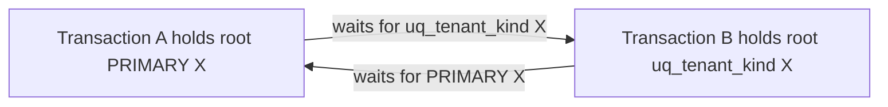

# Task 15 feedback concurrency root cause, correction and verification

2026-11-05. **Identified root-lock inversion corrected and locally verified on
disposable MariaDB 11.8.9.** No Hostinger connection, production configuration,
migration, constraint/trigger modification or frontend feature change. Overall
production verdict remains NOT READY — CRITICAL BLOCKERS for other Task 14 gates.

## Reproduction and exact database evidence

Task 14 reported ER_LOCK_DEADLOCK in concurrent duplicate FeedbackService.submit
calls; its historical wait graph was not retained. We therefore do not pretend
to reconstruct that particular old transaction's exact schedule. Investigation
reran the original duplicate scenario (including 3,000 pre-fix pairs without a
failure in that run), then reproduced an actual cycle deterministically using the
unchanged application root-lock statements and server-observed transaction waits.
The controlled SQL reproduction is retained as a negative control in the suite.
It exercises the shared feedback/quota/auth locking mechanism, not mocked errors.

Legacy public-funnel entry:

```sql
SELECT id FROM tenants WHERE kind='platform' AND status='active' FOR UPDATE
```

Legacy quota/invitation entry or reacquisition:

```sql
SELECT id FROM tenants WHERE kind='platform' FOR UPDATE
```

Actual EXPLAIN on the 11.8.9 fixture:

| Statement | Access | Index | Estimated rows |
| --- | --- | --- | --- |
| Legacy public entry | index scan | ix_tenant_children | 10 |
| Legacy quota entry | index scan | uq_tenant_kind | 10 |
| New shared helper | const | uq_platform_slot | 1 |

Neither legacy predicate used a leading unique equality lookup. Projection and
predicate differences selected different covering secondary scan paths. A logical
"same platform row" intention did not establish a common physical lock order.

Deterministic schedule, no arbitrary sleep ordering:

1. Transaction A executes the legacy public entry and retains the root PRIMARY
   record X lock (plus its scan locks).
2. Transaction B starts the legacy quota entry, obtains the uq_tenant_kind root
   record X lock, and waits for A's PRIMARY record. The harness observes that wait.
3. A executes its quota root reacquisition and waits for B's uq_tenant_kind record.
4. MariaDB detects the cycle and rolls back a victim. Captured result:
   **errno 1213, code ER_LOCK_DEADLOCK, SQLSTATE 40001**. Captured waiting SQL was
   the legacy quota statement above. Transaction/thread IDs vary by fixture.



SHOW ENGINE INNODB STATUS identifies both transactions, statements, indexes,
exclusive record waits and chosen victim. Before the cycle we retain the live
waiting thread/index evidence. The legacy reproduction requires no feedback INSERT,
status UPDATE, audit INSERT or trigger execution: **feedback triggers are not the
cause of this reproduced cycle**. It proves an application SQL lock-order defect,
not corrupt constraints or duplicate-key enforcement failure.

The test initially tried INNODB_LOCK_WAITS joined to INNODB_TRX. On this fixture,
new const-table waits during query optimization (process state Statistics) were
visible in the engine transaction list before that metadata join exposed them.
The final harness observes actual engine waits, using bounded polling rather than
timing guesses, and drains all jobs in cleanup even if an assertion fails.

## Smallest safe correction

One helper in auth/database.ts now supplies **every locking platform lookup**:

```sql
SELECT id,status FROM tenants WHERE platform_slot=1 FOR UPDATE
```

Read-only paths use the same projection/predicate with LOCK IN SHARE MODE.
`platform_slot` is the existing generated unique key, defined/enforced by migration
000002. Only the platform row can occupy slot 1. There is no new DDL or migration.
The complete id/status projection avoids differing covering-index access choices;
all mutex entry/reacquisition paths use this one query. Public code checks the
returned active status and preserves its generic unavailable response.

Updated callers: FunnelService.publicRecord, QuotaService.state,
TenantService.actor and AuthService invitation consumption. Auth audit's nonlocking
root lookup also uses the same unique selector. No kind/parent mutation, global
permission grant, alternate scope or client-owned root ID was introduced.

The correction removes the reproduced secondary/clustered inversion and broad
root scans. It does not remove the root mutex, transactions, FK/checks, immutable
triggers, audit insertion, quota locks, token checks, nonce uniqueness or CAS.
**No new automatic retry was added.** Existing TenantService bounded DB-only retry
behavior is unchanged; the stress suite checks MariaDB's global deadlock counter
so that existing retry code cannot conceal new application deadlocks.

## Transaction ordering and trigger review

| Operation | Preserved ordering after correction |
| --- | --- |
| Public submission | Unique root X → validated funnel/ancestors → signed token/duplicate lookup → provisional feedback → same root reacquisition → subscription/counter X → ledger/counter → public audit → commit |
| Feedback status | Auth user → unique root X → revalidated session/member/ancestry → feedback/version CAS → status event → audit → commit |
| Feedback/public reads/events | Same unique root shared → scoped projection/history/count → allowed audit/event → commit; no lock upgrade into quota writes |
| Branch/link/QR/subscription writes | Existing actor guard unique root X before resource/quota work; repeated quota lock is the same point lookup |
| Merchant invitation acceptance | User → unique root X → token/member/ancestry → activation → same root/quota/counter → audit/token consumption → commit |

Reviewed private_feedback FKs (funnel, link, membership), uq_feedback_submission,
ownership/rating checks and protect_private_feedback_owner trigger; status-event
FKs/append-only guards; audit tenant/user/member FKs and append-only guards; quota
subscription/counter/ledger ownership. These constraints remain intact. Status and
public writes still serialize before touching shared business/audit data. Other
transaction families can in principle encounter unrelated future deadlocks; this
is not a claim that arbitrary SQL, privileged writes or future code can never
deadlock. Unexpected transaction errors still roll back and propagate safely.

Unit coverage proves deadlock and connection-loss failures perform work once,
rollback/release once and never automatically replay or reconnect after an
ambiguous commit. Retrying a request is governed by existing signed feedback
idempotency, not a generic SQL exception retry loop.

## Deterministic regression and stress results

Command: `npm --prefix backend run test:feedback:concurrency`, with MARIADB_TEST_BIN
pointing only to local Windows MariaDB 11.8.9 ZIP binaries. No external target or
environment file is accepted. Service-level stress avoids HTTP rate-limit noise;
the unchanged real-HTTP feedback suite and full browser E2E run separately.

Eight scenarios plus parent (9 tests): legacy engine cycle; 20 scheduled fixed
point-lock/contention rounds; 300 concurrent duplicate pairs; distinct submissions
across three merchants/four branches (two branches share a merchant); concurrent
status CAS; submit/status overlap; four workers × 50 mixed rounds; concurrent
audit failure versus valid submission on another merchant.

Each final fixture finishes with exactly **508 feedback rows, 508 submission audit
events, 202 status events and 202 status audit events**. No missing submission
audit, duplicate feedback, version/history-count mismatch, partial failed write or
quota/ledger mismatch remains. Two same-version status writers produce one success
and one controlled 409, not lost updates. Failed audit insertion rolls feedback,
counter and ledger back while unrelated valid concurrent work completes.

Three consecutive final counter-checked runs pass: **900 duplicate-pair rounds,
600 mixed worker rounds, 60 point-lock schedules**, with 1,524 committed feedback
rows and 606 status events across three disposable fixtures. Each run deliberately
reproduces exactly one **legacy negative-control** engine deadlock; the subsequent
corrected application traffic adds **zero** to Innodb_deadlocks. Expected legacy
cycles retained in the engine's last-deadlock section are not corrected-path failures.

## Complete regression validation

| Command | Passed |
| --- | ---: |
| Backend unit/foundation (`npm --prefix backend test`) | 27 |
| test:feedback:concurrency | 9 |
| test:feedback:integration | 13 |
| test:quotas:integration | 9 |
| test:subscriptions:integration | 12 |
| test:funnels:integration | 10 |
| test:business:integration | 11 |
| test:tenants:integration | 12 |
| test:auth:integration | 16 |
| test:schema:integration | 10 |
| test:migrations:integration | 8 |
| Frontend npm test | 17 |
| npm run test:browser | 8 |
| npm run test:e2e:real | 11 |
| npm run test:server | 1 |

**174 distinct test cases pass**, none failed/skipped in final validation, including
Node parent tests. Dedicated concurrency repetitions are additional runs, not new
distinct tests. Both TypeScript checks, frontend/backend production builds and
git diff --check pass. Lint has no errors and only the two existing landing/demo
warnings. No existing test was disabled, weakened or replaced with mocks.

## Artifacts and complete file inventory

Ignored local evidence under `.tmp-frontend/deadlock/`: plans.json,
legacy-waits.json, legacy-error.json, legacy-innodb-status.txt,
final-innodb-status.txt and result.json. Evidence contains only disposable synthetic
data; no production credential or raw auth/submission token is reported. Earlier
investigation-only diagnostics may also remain in that ignored directory.

Created:

- backend/test/feedback-concurrency.integration.mjs — real-engine negative control,
  scheduled concurrency, multi-worker stress and integrity/engine-counter assertions.
- backend/test/feedback-concurrency.test.mjs — rollback/release/no-replay unit checks.
- backend/docs/feedback-concurrency-report.md — this root-cause/test/inventory report.

Modified:

- backend/src/auth/database.ts — common unique platform-lock helper.
- backend/src/auth/service.ts — invitation helper and unique nonlocking audit lookup.
- backend/src/funnels/service.ts — common public shared/exclusive root lookup.
- backend/src/subscriptions/quota.ts — same root reacquisition.
- backend/src/tenants/service.ts — same actor root-lock path.
- backend/package.json — explicit concurrency test command.
- backend/docs/feedback-api.md — corrected lock/retry contract pointer.
- backend/docs/feedback-security-report.md — current concurrency evidence.
- backend/docs/security-audit-report.md — H1 local remediation status.
- backend/docs/production-blockers.md — H1 local closure and remaining gates.
- backend/docs/production-readiness-report.md — historical audit versus new evidence.

H1's identified root-lock inversion is remediated **locally**. Provider validation,
capacity/lock budgeting and all other production blockers remain. This task does
not authorize production access or establish production readiness.
