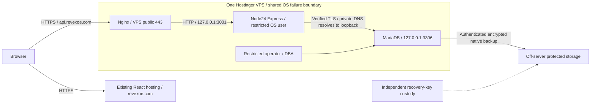

# Option C: API and MariaDB on one VPS

2026-11-10. Read-only assessment, with documentation deliverables only. No code,
credentials, infrastructure, DNS, production connection, migration or bootstrap
changed. **Production initialization remains NO-GO.**

## Recommendation

For the stated requirement that database port3306 be inaccessible from the public
internet, **prefer Option C over the presently unverified Option B**, conditional
on competent VPS administration and recovery. Co-locating API and database removes
the Cloud-to-VPS egress/private-network dependency. It does not remove TLS,
identity separation, recovery or release gates, and increases the impact of a VPS
compromise/outage. B remains attractive if a supported private route is later
proved and operational separation is preferred; public-only B does not meet this
specific no-public-database-listener design.

React stays on its existing hosting at revexoe.com. No technical requirement found
requires moving it. Keep VITE_API_URL=https://api.revexoe.com/api/v1, the API origin,
frontend CSP/CORS expectations and public URLs unchanged. Here “full VPS” means
API plus database, not the frontend, email or all other hosted sites.

## Evidence and assumptions

Reviewed all six existing HOSTINGER_VPS reports, production-migration-runbook.md,
deployment-runbook.md, task-21-workflows.md, the initial Hostinger runbook, trigger
map and actual env/transport/pool/server/app/operator/bootstrap/recovery source.
No referenced report was missing. Repository baseline: Node24, Express5, direct
mysql2, MariaDB11.8.x validation,85 migrations000000-000084,32 tables including
ledger and46 triggers. Prior336 tests are historical local evidence, not VPS
certification. The existing Cloud DB is empty only according to prior operator
evidence; no fresh production inventory was performed.

This assessment adds a recommendation for C; it does not rewrite earlier B reports
or declare their conditional findings invalid. No VPS, region, address, certificate,
service unit, account or production release has been independently verified.

## Proposed topology

Only HTTPS443 and optionally HTTP80 for redirect/ACME are public. SSH uses an
approved restricted administration path. Node3001 and MariaDB3306 bind IPv4
loopback only; block public IPv4/IPv6 access at host/provider firewalls too. No
Docker published database port, public bind, remote SQL allowance or phpMyAdmin
deployment is proposed. Validate listener and external denial independently later.

Keep one API process initially: present rate limits are process-local. Separate
OS service users, root-owned immutable release directories, narrowly readable
runtime secrets/CA and operator-only credentials reduce lateral access. OS root
and DBA remain trusted high-authority principals. One VPS is not physical isolation
or high availability; a host compromise can reach both API and database.

## Capacity, region and versions

Planning assumptions: <=10GB database/indexes, growth<=1GB/month, <=2 sustained API
requests/second with bursts<=10, one Node process, no analytics warehouse, local AI
model or HA replica. Login Argon2, QR generation and backup CPU/memory must be load
tested. These are assumptions, not measured production demand.

Recommend a **4vCPU/16GB/200GB KVM4 evaluation candidate** for API+DB headroom under
these assumptions. A2vCPU/8GB/100GB KVM2 is a lower-cost pilot candidate only after
combined API/DB/backup load proves capacity. Build artifacts off the live host where
possible. Initial16GB budget proposal: roughly6-8GB InnoDB pool, bounded Node/native
memory, remaining OS/cache/connection/backup headroom; do not approve a production
heap or connection cap without measurement. Retain application pool5 initially,
budget all processes/operators and test pool exhaustion. Alert before disk75%
as a proposed threshold; reserve space for DDL copies, binlogs, temporary files and
backup staging. Do not keep the only backup on that disk.

For an India-majority audience, prefer the available India VPS region after owner
data-residency approval and client-latency measurements; confirm exact city and
stock at order time. Hostinger currently lists India among VPS locations; the
existing SSH hostname does not establish the future VPS location.
[Hostinger locations](https://www.hostinger.com/support/1583267-where-are-hostinger-servers-located/)

Propose Ubuntu24.04 LTS with signed official MariaDB11.8 packages and patched
Node24.x. Rehearse11.8.9 initially for parity; verify package availability/security
status and approve later11.8 patch updates after compatibility/restore tests.
Do not assume the OS default package is11.8, substitute MySQL, or freeze a vulnerable
build to retain an old test result. Preserve InnoDB, utf8mb4_unicode_ci, UTC,
strict SQL, FK/CHECK enforcement, generated PERSISTENT columns and BIGINT strings.
[MariaDB package guidance](https://mariadb.com/docs/server/server-management/install-and-upgrade-mariadb/installing-mariadb/binary-packages/installing-mariadb-deb-files)

## Cost and ownership comparison

Public India pricing checked2026-11-10; monthly equivalents are prepaid term
offers, not monthly invoices. Checkout/taxes/availability and the user's actual
renewal contract need confirmation.

| Product | Intro equivalent / commitment | Displayed renewal equivalent |
| --- | --- | --- |
| Cloud Startup | INR599/month; INR28,752 for48months | INR1,599/month, same term |
| VPS KVM2:2vCPU/8GB/100GB | INR779/month; INR18,696 for24months | INR1,199/month, same term |
| VPS KVM4:4vCPU/16GB/200GB | INR1,099/month; INR26,376 for24months | INR2,399/month, same term |

Sources: [Cloud pricing](https://www.hostinger.com/in/cloud-hosting),
[VPS pricing](https://www.hostinger.com/in/vps-hosting). Terms differ, so these
are not equivalent total-contract quotes. Existing Cloud billing is unknown.
Because React and potentially other services remain there, **do not count Cloud
cancellation as a saving**. C costs retained frontend hosting plus VPS plus backup,
monitoring, encryption/keys and administrator/on-call labor. B has similar retained
hosting and DB VPS costs but less API operations work; KVM2-vs-KVM4 is a sizing
assumption, not an intrinsic price difference between architectures.

Hostinger VPS is self-managed; owner takes responsibility for OS, Node, proxy,
certificates, MariaDB, patching, monitoring and recovery.
[Responsibility model](https://www.hostinger.com/support/8311982-what-is-managed-hosting-in-hostinger/)
Planning estimate:2-4 engineer-days API/proxy/service migration plus3-6 days TLS,
identities/recovery and2-4 days acceptance/rehearsal, with overlap possible;
provider/approval waiting excluded. Allow8-16 hours/month pilot administration plus
incident on-call, subject to measurement and an agreed labor rate. These ranges
are estimates, not delivery commitments. Backup/storage add-on prices are unknown.

See [security](HOSTINGER_FULL_VPS_SECURITY.md),
[deployment](HOSTINGER_FULL_VPS_DEPLOYMENT_PLAN.md),
[recovery](HOSTINGER_FULL_VPS_RECOVERY_PLAN.md) and
[decision gates](HOSTINGER_FULL_VPS_GO_NO_GO.md).
