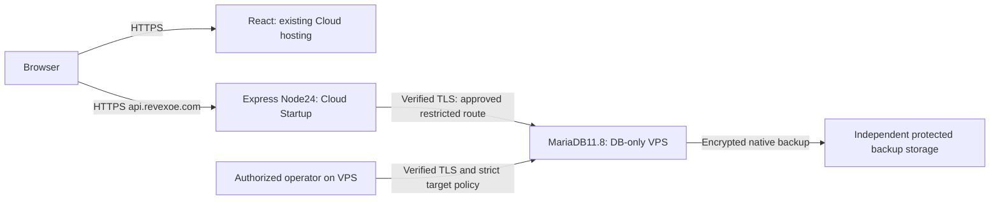

# Hybrid Cloud Startup application and VPS MariaDB feasibility

2026-11-12. Investigation and disposable local testing only. **Architecture:
CONDITIONAL. Production: NO-GO.** No production probe, Hostinger access, purchase,
provisioning, DNS/environment/grant change, migration, real owner creation, deployment,
commit or push. Initial working tree was clean at `845f8d8`. Only this report changed.

## 1. Executive decision

**Q1: Can Node stay on Cloud Startup while MariaDB runs on a Hostinger VPS?**
Yes at the application/protocol level, conditionally at the hosting level. The
existing mysql2 pool, strict TLS, migration and bootstrap paths support a DNS-named
MariaDB endpoint with an approved CA. Current Hostinger documentation explicitly
permits outgoing port3306. Actual Cloud egress identity, restricted routing, persistent
CA access and Linux recovery remain unverified. This is not a deployable GO.

**Q2: Is hybrid preferable to full VPS?** For minimum application disruption,
conditionally yes, if a supported private route or explicitly accepted tightly
allowlisted public TLS route is demonstrated. Keep React and Express where they are;
no API DNS cutover is needed. If no publicly reachable SQL listener is a mandatory
requirement and no private Cloud-to-VPS path exists, full VPS is preferable: API and
DB can communicate over loopback with verified DNS TLS. Full VPS adds proxy, API
supervision and frontend operations, and concentrates failures/root compromise.

**Q3: Minimum practical cost/responsibility?** The prudent DB-only planning candidate
is KVM2 at **INR779/month equivalent, INR18,696 paid for24months**, renewing at
INR1,199/month equivalent, plus the existing Cloud bill and unquoted protection/
operations costs. INR599 KVM1 is the smaller available offer, not a validated
production capacity minimum. The owner must supply a competent Linux/MariaDB
administrator, monitoring, patching, PKI, encrypted backup and tested restoration.
Prices and annual equivalents appear below; no purchase is recommended before
network feasibility is established. [Official VPS prices](https://www.hostinger.com/in/vps-hosting).

Labels in **this task** are A=hybrid, B=full VPS, C=eligible managed DB. Earlier
HOSTINGER_VPS reports used B=hybrid and C=API+DB VPS with React retained. Here
full VPS means the entire application; retaining React on Cloud is a separate
variant and retains its hosting bill. Do not confuse these options.

## 2. Evidence and hosting capabilities

Reviewed actual transport/CA/pool/env/server/app, migration operator/runner/schema/
privileges, setup/bootstrap, recovery and relevant tests; the Cloud alternatives,
grant compatibility, implementation and production migration reports/runbooks;
and existing VPS network/cost and Option C/Linux validation assessments.

| Evidence | Result and boundary |
| --- | --- |
| Repository | Node24/Express/TypeScript, mysql2 direct SQL;85 immutable migrations000000–000084,32 tables,46 triggers. No ORM/provider rewrite needed. |
| Current official connectivity guidance | Outgoing ports described as open except0/25;3306 explicitly listed. Confirms published policy, not an actual app-to-VPS connection or source IP. |
| Cloud Node limits | One long-running process/site; shared plan resources,120-second request limit, no always-running background workers. Do not assume a tunnel/VPN sidecar is supported. |
| Owner/support evidence | Managed DB11.8.9, one customer user, database-wide permissions, no separate provider definer and declined raw-grant correction. These were not queried live here. |
| Not verified | Private Cloud/VPS network, stable outbound IPv4/IPv6, socket/NAT caps, CA mount persistence, actual region/latency, Linux recovery, current source DB state or deployed artifact identity. |

Hostinger documents outgoing3306 and dedicated Cloud IPs, but does not thereby
promise the inbound dedicated IP is the Node application's stable outbound identity.
VPN support is documented for VPS, not Cloud. Do not reinterpret its WebSocket
guidance as a SQL protocol restriction.
[Connectivity policy](https://www.hostinger.com/support/which-web-standards-and-connectivity-features-are-supported-at-hostinger/),
[Node limits](https://www.hostinger.com/support/hostinger-node-js-limits-for-web-and-cloud-plans/).

No eligible Hostinger-managed MariaDB service meeting the required CA/identity,
exact-scope and separate-account controls was identified in the reviewed official
documentation. This is not proof no future/custom product exists. Current Cloud
DB remains unsuitable under the confirmed constraints: immutable prefixed names,
raw wildcard schema grants, one user and shared-definer authority. A renamed suffix
or checkbox reduction does not fix the scope. See
[tested Cloud alternatives](HOSTINGER_CLOUD_STARTUP_ALTERNATIVES.md).
[Hostinger database rules](https://www.hostinger.com/support/1583542-how-to-create-a-new-mysql-database-in-hostinger/),
[documented database engine](https://www.hostinger.com/support/1583226-which-database-management-system-is-used-at-hostinger/).

## 3. Proposed topology and network approval

Preferred route is a provider-supported private path with documented addressing
and isolation, still using TLS. Alternative is separately reviewed public routing:
MariaDB binds only the intended interface; provider AND host firewalls deny all
unapproved IPv4/IPv6 sources; allow only proven minimal Cloud sources and separately
approved administration. Never allow0.0.0.0/0 or::/0, expose phpMyAdmin publicly, or
use a laptop tunnel as production infrastructure. Shared egress is reachability
filtering, not per-tenant authentication. If addresses change unpredictably, stop;
do not widen the allowlist to regain connectivity. A DB bound only to VPS loopback
cannot serve the Cloud app without a separately designed supported route/proxy.

### Questions requiring written Hostinger answers

1. Does outgoing3306 policy apply to this exact Cloud Node runtime/subscription and
   selected VPS destination? Any connection/concurrency, throttling or NAT idle limits?
2. What IPv4/IPv6 sources actually leave Node after builds, restart, failover and
   region moves? Dedicated or shared, guaranteed stability/change notice, paid
   static-egress option and cost? Website/SSH IP alone is insufficient evidence.
3. Is a supported private Cloud-to-VPS network available? Regions, routing, DNS,
   isolation, lifecycle and price? Same provider/region is not proof of a bridge.
4. Can the actual process persistently read an operator-managed CA file outside
   public assets across deployments, with safe replacement/permissions?
5. Which region pair minimizes measured RTT? What are traffic/egress charges and
   socket limits? Confirm startup probe semantics and readiness timeout support.
6. What isolated restore route preserves accounts/definers? Backup scope, encryption,
   retention, restoration access and responsibility? Obtain actual add-on quotes.

These are hybrid-network/recovery questions, not another request for the already
declined managed-DB grant workaround. No provider query or network probe was sent.

## 4. TLS and application settings

The existing `databaseTransport` requires a DNS hostname for required TLS; an IP
literal is refused even if a certificate contains an IP SAN. Provision an approved
DB DNS identity resolving over the selected route, with matching DNS SAN, valid
server certificate/chain/lifetime and protected server private key. Independently
authenticate the CA bundle and pin SHA256 of its exact PEM bytes. Do not promote
an arbitrary presented certificate to trust. CA signing key stays outside API
runtime. Server accounts must require TLS; rehearse plaintext rejection.

| Runtime variable | Proposed requirement; actual values require operator input |
| --- | --- |
| DB_HOST / DB_PORT | Approved DNS hostname /3306 if approved route uses3306 |
| DB_NAME | Dedicated exact schema; all schema-scope underscores/percent signs explicitly escaped in grants, including SHOW GRANTS representation |
| DB_USER / DB_PASSWORD | Separate strict runtime identity/private approved credential; production password strength unchanged |
| DB_TLS_MODE | `required` |
| DB_TLS_CA_FILE | Real persistent backend-readable protected CA path, not a public/static file |
| DB_TLS_CA_SHA256 | Independently approved64hex SHA256 of exact file bytes |
| DB_CONNECTION_LIMIT | Default5 initially; review aggregate budget across instances/deploy overlap/operators |

Remove HOSTINGER_LOCAL approval inputs and Cloud database-wide exception policy
fields for this design. Preserve all origin/CORS, access/MFA and SMTP validation;
frontend VITE_API_URL remains the public HTTPS API /api/v1 URL. Keep the supported
Cloud backend root/build/start/assigned HTTP port. Do not select the VPS-specific
single-Nginx-loopback proxy mode for an unverified Cloud ingress topology.

`approvedCa` and both pool/operator require exact bytes, parse certificates and
configure rejectUnauthorized/verifyIdentity/minTLS1.2. The previously reported
operator empty-CA defect is **already fixed** in current source; old assessment
warnings are historical. Required mode validates before constructing a pool and
never falls back. Verify deployed source/compiled identity separately before use.

Startup constructs a lazy pool and listens without waiting for DB or SMTP. Remote
latency therefore affects readiness/business operations, not a deliberate startup
connection wait. `/health` and `/health/live` remain independent; `/ready` and
`/health/ready` require SELECT1 and non-draining state. Probe bounds:3-second connect,
3-second query,4-second overall readiness race. A three-second readiness deadline
is insufficient; use separate liveness/startup and readiness above4s plus margin.
Readiness does not establish schema/grants/SMTP/MFA/provider readiness.

No timeout/pool change is justified without RTT/load evidence. Pool refuses queues,
uses keepalive and limits1–50 connections; failed/end connections are removed and
later requests can establish fresh TLS connections. This is not transparent replay
of failed transactions. Never add blind mutation retries. Measure pool exhaustion,
idle-socket/NAT expiry, DNS/certificate rotation, outage/recovery and transaction
latency on approved staging; preserve ambiguity handling on connection loss.

## 5. Accounts, triggers, migration and bootstrap

Use the original strict profiles, not Cloud database-wide exceptions:

| Principal | Required boundary |
| --- | --- |
| Runtime | Exact per-table `runtimePrivileges` SELECT/INSERT/UPDATE subsets; no DELETE, TRIGGER, DDL, ledger access, roles/admin or GRANT OPTION. Only this credential in Cloud API runtime. |
| Migration | Exact-schema SELECT/CREATE/ALTER/TRIGGER; table-scoped ledger INSERT/UPDATE and four seed-table INSERT grants as verifier requires. No global authority except USAGE. Protected operator only. |
| Creating definer | Unchanged SQL makes migration identity the definer. Retain reviewed activation rights: TRIGGER on23 subject tables and SELECT dependencies on18 tables; protect this non-runtime identity and rehearse reduction. |
| Bootstrap | Separate protected identity, schema/ledger metadata and SELECT, four bootstrap INSERT targets; temporary reviewed TRIGGER visibility may be necessary. Never give this to runtime. |
| Backup | Separate protected SELECT/TRIGGER/LOCK TABLES profile as proven in native fixture; review metadata/version requirements; no application DML/DDL. |
| DBA/restorer | Separate privileged administration, approved definer restoration/account creation and grant transitions, unavailable to API. Exact recovery privileges require Linux rehearsal. |

Migration and definer are separate **roles**, coalesced into one non-runtime
principal for the minimum unchanged-artifact design. Five fully independent users
are not established by that design. An independent creating-definer execution
strategy requires separate review; do not add global SET USER to the strict
migration account or edit historical trigger SQL. All46 dependencies are recorded
in the [trigger map](HOSTINGER_TRIGGER_PRIVILEGE_DEPENDENCIES.md).

Escaped schema grants must replace unsafe broad grants, not merely supplement
them. Disposable tests exercise intended/lookalike schema access and actual denied
operations. A VPS DBA can create exact grants independently of hPanel naming;
that capability does not establish actual production grants or tenant isolation.

Future approved initial workflow: freshly inventory source/target and verify backup/
restore; stage matching Linux artifact/native dependencies; create exact TLS target
policy pinning schema,@@hostname,CURRENT_USER,11.8 version and allowed definers;
run non-mutating preflight; review85 pending checksums/schema/grants; obtain separate
apply approval within15minutes and canonical production confirmation; retain
exclusive fsynced audit; verify full history/schema and strict runtime. Execute
from an authorized VPS-side operator environment, not through a local-only CLI.
Existing named lock/session checks, manifest, applying/failed states and no automatic
repair/retry remain. DDL is not one rollbackable transaction. SQL-only phpMyAdmin
import is not an equivalent migration path. Older runbook67-row counts are obsolete
for this85-step release. [Production operator runbook](../backend/docs/production-migration-runbook.md).

Only after complete schema/recovery/grant verification: separately approve first
owner bootstrap with private operator inputs and canonical target digest. Existing
workflow prevents second root/password overwrite and creates no MFA-verified session.
Tests use synthetic identities only. Metadata test shows schema SELECT plus narrow
INSERT sees5/46 triggers; protected temporary TRIGGER authority sees46 and permits
structural verification. Design/revoke this temporary authority explicitly.

The exposed MFA candidate must be assessed/remediated under separate approval:
unused key replacement versus used-record reencryption/recovery. Preserve matching
encrypted data and existing access key; never copy the exposed candidate or prior
shared password. First owner must complete MFA; no real owner was created here.

## 6. Version, sizing, costs and operating model

Propose Ubuntu24.04 LTS and approved MariaDB11.8.x packages, initially11.8.9 for
artifact parity if securely available; verify signed repository/package availability
and current security maintenance before selecting a patch. Default Ubuntu packages
must not be assumed to supply11.8. Node24 stays on Cloud for A. Linux/native package,
OS/DB patch upgrade and compatibility rehearsal remain outstanding.

Sizing assumptions, **not measured production demand**: DB+indexes<=10GB,
growth<=1GB/month,<=2 sustained/10 burst API requests/sec, one Node instance, no HA
or warehouse workload. DB-only KVM2 provides maintenance/recovery headroom; KVM1
needs a demonstrated low-load fit. Full VPS KVM4 is a conservative benchmark
candidate for API/Argon2/proxy/DB contention, not a mandatory minimum.

India public prices checked2026-11-12. Annual figures are12x monthly equivalents,
not annual billing offers. VPS offers require24-month upfront; Cloud offer48months.
Taxes, final checkout, region and existing contract can differ.

| Plan | vCPU/RAM/NVMe | Intro/month; annual equivalent | Renewal/month; annual equivalent | Intro upfront |
| --- | --- | --- | --- | --- |
| KVM1 |1/4GB/50GB |INR599;7,188 |INR999;11,988 |INR14,376/24months |
| KVM2 |2/8GB/100GB |INR779;9,348 |INR1,199;14,388 |INR18,696/24months |
| KVM4 |4/16GB/200GB |INR1,099;13,188 |INR2,399;28,788 |INR26,376/24months |
| Cloud Startup public new-plan reference |Published4CPU/4GB/100GB; shared sites |INR599;7,188 |INR1,599;19,188 |INR28,752/48months |

[VPS offer/renewal cards](https://www.hostinger.com/in/vps-hosting),
[Cloud offer/renewal card](https://www.hostinger.com/in/cloud-hosting).

| Requirement | A: Cloud app + DB VPS | B: entire app + DB VPS | C: eligible managed DB |
| --- | --- | --- | --- |
| Security/isolation | Strict separate SQL identities; Cloud app and DB OS separated; inter-host route dependency | Same strict identities; loopback SQL possible; shared root/outage/resource boundary | No qualifying current offering verified |
| TLS/network | DNS/CA TLS supported in source; private/restricted egress unverified | DNS/CA TLS over loopback; listeners/OS still need independent validation | Current managed CA/identity/scope constraints fail |
| Migrations/triggers/bootstrap | Existing85/46/strict workflow fits engine; Linux/provider rehearsal outstanding | Same; add API/proxy/service acceptance | Confirmed current plan incompatible; no bypass |
| Incremental hosting/month; year |KVM2 INR779;9,348 intro /1,199;14,388 renewal + actual existing Cloud bill |KVM4 INR1,099;13,188 intro /2,399;28,788 renewal if entire Cloud dependency can retire |UNVERIFIED/not eligible; current Cloud already billed, not a valid secure alternative |
| Backup cost |Weekly provider backup included; daily add-on UNVERIFIED; encrypted off-VPS storage/retention/traffic UNVERIFIED |Same plus API/service/PKI recovery |Eligible service/backup quote UNVERIFIED |
| Management/migration |DB OS/PKI/monitor/backup; smaller app move, network coordination |DB plus Nginx/HTTPS/systemd/API/frontend/builds; larger migration/cutover |Would reduce DBA work only under an actual service contract |
| Operational risk |Two service/network dependencies; egress changes and latency |One host failure/root authority; self-managed web and DB |Provider features/SLA and security evidence absent |

Actual Cloud cost is unknown: A total is current Cloud monthly/yearly cost + above
increment. For illustration only, newly advertised Cloud+KVM2 equalsINR1,378/month
or16,536/year equivalent intro, andINR2,798/month or33,576/year renewal; the terms
differ and this is not the owner's invoice. B saves Cloud charges only if React,
other domains/email/plan dependencies and contract obligations permit retirement.
Retaining Cloud frontend adds its real bill to B. No automatic savings claimed.

Planning effort, not measured staffing/SLA: A6–12 scheduled administrator hours/month
plus incidents/on-call; B8–16 plus incidents. Price labor at the owner's actual rate.
Initial setup/rehearsal requires separate scope and Linux recovery work, not just
buying a server. Hostinger identifies VPS as self-managed; managed Cloud does not
manage a customer's external MariaDB.
[Management responsibility](https://www.hostinger.com/support/8311982-what-is-managed-hosting-in-hostinger/).

## 7. Recovery and operational risks

Provider weekly backups are a secondary layer, not proof of consistent MariaDB
recovery. Hostinger documents no default at-rest encryption for VPS disks/backups/
snapshots. Daily backup add-on price is unverified. Require approved at-rest
protection or explicit risk acceptance, application-level encrypted native dumps,
independently protected off-VPS copy/key custody and retention/RPO/RTO decisions.
[Provider backup and encryption limits](https://www.hostinger.com/support/1583232-how-to-back-up-or-restore-a-vps-at-hostinger/).

The shipped recovery executor is Windows/disposable-only, **not** a production Linux
restore tool. The [native Linux recovery procedure](../ops/option-c/linux-validation/NATIVE_RECOVERY_PROCEDURE.md)
is reviewable but unexecuted. Rehearse native TLS backup and isolated Linux restore:
accounts/grants provisioned separately, original definer principals valid before
import, all85 ledger checksums/32 tables/46 exact trigger bodies/definers, rows,
indexes/FKs/CHECKs/auto-increments and matching synthetic MFA verified. Exercise all46
guards and strict runtime denials after restoration. hPanel import is not assumed
to preserve definers. Restore must not replace production automatically.

Wrong key, tamper, truncation, incomplete import and unexpected target must stop.
Record measured restore time and accepted data-loss budget; suggested RPO/RTO in
older reports remain proposals. A listed Cloud backup is not a tested VPS recovery
plan. Root/backup-account compromise, stolen API credentials across all tenants,
disk full/OOM, expired certificate, single-primary outage and provider-account
compromise remain risks. Strict grants do not replace application tenant isolation.

On migration failure preserve ledger/audit/committed-DDL state and freeze writers;
no automatic retry, ledger deletion, checksum edits or destructive rollback. Review
repair on an isolated restored clone and obtain fresh approval. After writes begin,
reverting DB_HOST is not rollback: require write fencing and reconciliation/restore
to prevent two writers and lost new data.

## 8. Local validation executed for this investigation

Windows Node24.14.0, harness-owned MariaDB11.8.9 and synthetic credentials/PKI only.
Tests bind disposable loopback listeners and never adopt an existing database.
No production environment/credential file read. Logs ignored under
`.tmp-frontend/hybrid-feasibility/`.

| Executed command/check | Actual result |
| --- | --- |
| `npm.cmd --prefix backend test` |Backend build passed;92 tests passed,0 failed/skipped/cancelled |
| `node --test --test-concurrency=1` with the eight integration files below |105 passed,0 failed/skipped/cancelled;82.7seconds |
| `npm.cmd --prefix backend run typecheck` |Passed |
| `npm.cmd run lint` |Passed |
| Offline `loadMigrations` + `validateManifest` |85 versions000000–000084 accepted |
| Historical SQL/verification/manifest Git diff |Unchanged |
| Report local links/whitespace and `git diff --check` |Passed |

**197 test cases passed**, including node:test parent cases. Integration selection:
`cloud-managed-alternatives.integration.mjs`, `hostinger-grant-scope.integration.mjs`,
`migration-safety.integration.mjs`, `cloud-startup.integration.mjs`,
`external.integration.mjs`, `mfa.integration.mjs`, `setup.integration.mjs`,
`recovery.integration.mjs`, all under `backend/test/`. The fixture-only
`MARIADB_TEST_BIN` points to the existing local11.8.9 Windows ZIP distribution.

Coverage exercised: real escaped/raw grant scopes and lookalike access; full strict
migration/manifest/history with32 tables/46 triggers; runtime DDL/ledger/append-only
denials; exact identity, drift, stale approval, lock contention, interruption,
durable CLI audit and failed-step recovery; all46 guard activation before/after
reduced-definer transition and native encrypted restore; trusted and wrong-CA/SAN
TLS with local SMTP; synthetic bootstrap concurrency/idempotency/conflicts and
mandatory MFA; encrypted native backup/restore, original definers, row/schema/FK
integrity and wrong-key/tamper/incomplete/interrupted restore rejection. Unit suite
includes startup/health/environment, operator CA negatives and proxy regressions.
Cloud shared-account cases are regression evidence, not the recommended VPS profile.

Manifest fingerprint:
`4a82e281add0066adf392e15a7f1135b0601607ebbf4b8eda5b7001491b35735`.

These establish engine/application compatibility, not Cloud-to-VPS networking,
Linux operational acceptance, sustained performance or production recovery. Real
Linux systemd/Nginx/listener, firewall IPv4/IPv6, offsite custody, reboot/unlock and
certificate lifecycle tests remain NOT_RUN. Historical full-suite totals are not
claimed as rerun here. No application change or security bypass was necessary.

## 9. Next steps and production decision

1. Obtain answers1–6 before buying; choose supported private route or explicitly
   approve restricted public TLS exposure. If neither is supportable, A remains
   blocked; assess B with its existing independent gates.
2. Owner approves architecture/budget, accountable DBA/on-call, identity/definer
   model, PKI/at-rest risks, encrypted recovery scope/retention and performance budgets.
3. Separately authorize disposable Linux/network rehearsal. Demonstrate source-IP
   stability, CA replacement, TLS negative cases,85 migrations,46 guards, bootstrap
   metadata, reduced grants, failure recovery and actual encrypted restore.
4. Independently resolve exposed MFA use/key remediation, then bind release approval
   to exact Linux artifact, current target inventory, tested recovery and maintenance
   window. Migration, bootstrap, configuration/deployment and traffic release each
   require explicit authorization; passing local tests grants none.

| Production gate | Current result |
| --- | --- |
| Source TLS/strict operator support |Supported and locally tested; no fallback required |
| Outgoing3306 published policy |Documented; actual route not probed |
| Stable restricted egress or supported private path |UNVERIFIED / BLOCKER |
| Real DNS SAN/CA custody/persistence and exact grants |NOT PROVISIONED / BLOCKER |
| Linux native encrypted isolated recovery and operations owner |NOT ACCEPTED / BLOCKER |
| Current inventory/artifact, MFA remediation and first-owner acceptance |NOT ESTABLISHED |
| Independent production migration/bootstrap/release approval |NOT GRANTED |
| Final outcome |**A CONDITIONAL; production NO-GO.** Stop after this report. |
