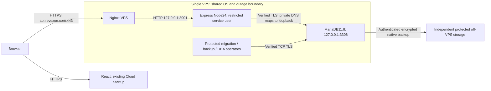

# VPS API and MariaDB feasibility; React retained on Cloud

2026-11-12. **Architecture feasible in principle; production NO-GO.** Read-only
investigation and disposable Windows testing only. No production connection,
purchase, provisioning, DNS/hPanel/environment/grant change, deployment, production
migration, real owner creation, secret access/rotation, commit or push occurred.
Initial Git HEAD was845f8d8; the existing untracked hybrid feasibility report was
preserved. This task adds only this report, with ignored local diagnostic logs.

## 1. Executive answers

**Q1. Can Express and MariaDB run securely together on one Hostinger VPS?**
Conditionally yes. The implemented strict DNS/CA TLS, separate SQL identities,
loopback API listener and narrowly trusted Nginx mode fit this topology. Co-location
removes the Cloud-to-VPS egress/private-network dependency. Linux service, PKI,
recovery and capacity acceptance remain outstanding. A shared VPS/root boundary
is not HA, physical database isolation or protection from a compromised DBA/root.

**Q2. Is KVM2 sufficient, or is KVM4 necessary?** KVM2 is a realistic **benchmark
candidate** for a small pilot, not a proven deployment size. No KVM-class load
measurement exists. KVM4 provides more headroom; neither plan fixes missing recovery
or administration. Choose after combined API/DB/backup and restoration tests under
owner-approved traffic, latency, memory, growth and RPO/RTO budgets. There is no
evidenced requests-per-second threshold at which KVM4 becomes necessary.

**Q3. Can React stay on Cloud while api.revexoe.com moves?** Yes. Retain
`https://api.revexoe.com/api/v1` as the frontend API URL and exact HTTPS origins/CORS.
An independently approved API A/AAAA cutover can change the destination while
preserving hostname, paths and browser TLS. React hosting, domain/email and other
Cloud dependencies need no move. No DNS change was made or live state verified.

**Q4. What before purchasing?** Confirm region/stock/checkout/renewal and upgrade
terms, an accountable Linux/DBA operator, patch/package sources, recovery/off-VPS
storage/at-rest design, acceptable one-host outage risk and a disposable Linux
acceptance route. Approve workload/performance and recovery budgets, PKI/custody,
identity model and spend. Do not buy merely because source tests pass.

Here A=API+DB KVM2, B=API+DB KVM4, C=Cloud backend+DB-only VPS. These are the latest
task's labels; earlier reports use different letters. Frontend stays on Cloud in
all three options. The [hybrid report](HOSTINGER_HYBRID_ARCHITECTURE_FEASIBILITY.md)
and [Cloud-only incompatibility](HOSTINGER_CLOUD_STARTUP_ALTERNATIVES.md) remain valid.

## 2. Architecture and evidence

Repository inspected: server/app/env/transport/CA/pool/proxy/password configuration,
operator/strict privileges/runner/schema, setup/bootstrap and recovery; production
migration runbook, existing VPS/Phase1/Phase2/Linux recovery reports and ops templates.
Proven code/artifact baseline: Node24, Express, TypeScript/mysql2,85 immutable
migrations000000–000084,32 tables including ledger,46 triggers. Hostinger VPS root
access and advertised resources do not prove that any proposed service, firewall,
certificate, grants or restoration is configured. No production artifact identity,
current DB inventory or live health has been independently verified.

## 3. KVM2 versus KVM4 and measurement requirements

| Resource / concern | KVM2 candidate | KVM4 candidate / decision consequence |
| --- | --- | --- |
| Published CPU/RAM/NVMe |2vCPU/8GB/100GB |4vCPU/16GB/200GB |
| API, DB and proxy |Plausible low-load single-process pilot; must share CPU with DB and operations |More concurrent CPU/memory headroom; still one host |
| Proposed initial InnoDB buffer budget |About2–3GB for rehearsal, tune from actual working set |About6–8GB for rehearsal, preserve OS/Node/recovery headroom |
| Argon2 |Current new hashes:19,456KiB (~19MiB),2 iterations,parallelism1 per hash, plus native/process overhead |Same security parameters; more hardware headroom, no weakening hashes |
| Node/native memory |Measure RSS, heap, native Argon2/QR and event-loop delay; heap limit alone does not cap RSS |Same; do not assign all spare RAM to DB or Node |
| Connection pool |Start with current5; budget operator/backup/deploy overlap; no query queue |Do not increase pool automatically with RAM/CPU |
| Storage |Fit data/indexes, temporary DDL copies, binlogs, logs and dump staging, not just live rows |Extra space delays pressure; does not replace growth alerts/off-VPS backup |
| Backup/restore |Benchmark encryption/compression/dump IO while serving representative load; isolated restore needs additional capacity |More headroom but restore time still must be measured |
| OS/Nginx/security/monitoring |Reserve memory/CPU/file descriptors; avoid live builds and intrusive scans at peaks |Same protections and measurements required |

Proposed pilot inputs only: DB+indexes<=10GB, growth<=1GB/month, one API process,
<=2 sustained requests/second and bursts<=10, no local AI model/warehouse/HA. These
are **not tested limits** or a production forecast; include login/recovery, QR,
public feedback, tenant transactions, AI/payment fixture paths and abusive bursts.
Concurrent HTTP requests are not the same as concurrent hashing or DB transactions.
Existing abuse limits stay intact; one process preserves current in-memory buckets.

Owner approves P50/P95/P99 latency/error budgets and headroom before testing. Run
steady/burst/soak and backup-overlap tests with representative data; record CPU,
RSS/swap/OOM, native hash latency, DB locks/IO, pool exhaustion, disk growth and
restore elapsed time. KVM2 is unsuitable if those budgets fail under a reviewed
configuration. KVM4 becomes a candidate when extra CPU/RAM/storage would address
the measured bottleneck; query/index/concurrency defects may need code work instead.
Higher demand may exceed both. No hardware capacity or performance guarantee is
inferred from the functional Windows tests below.

## 4. Linux deployment and service boundary

Propose Ubuntu24.04 LTS x86_64, supported signed MariaDB11.8 packages and native
clients;11.8.9 is the tested baseline. Verify exact patch availability/security
maintenance at implementation, and rehearse any newer11.8 patch. Ubuntu24.04's
default MariaDB series is10.11, so blindly installing its default package is not
equivalent. Official MariaDB distribution guidance covers Noble and version-specific
repositories; do not copy a generic installer selecting a different series.
[Ubuntu package series](https://documentation.ubuntu.com/project/SRU/reference/exception-MariaDB-Galera-Updates/),
[MariaDB DEB installation guidance](https://github.com/mariadb-corporation/mariadb-docs/blob/main/server/server-management/install-and-upgrade-mariadb/installing-mariadb/binary-packages/installing-mariadb-deb-files.md).

Use an approved supported Node24 Linux build with verified release checksums/signature
and native-compatible Argon2 dependencies, not Windows node_modules. Pin the tested
patch/artifact; the official archive provides Linux binaries and signed checksums.
Do not install packages in this investigation.
[Official Node24 archive](https://nodejs.org/en/download/archive/v24).

Stage backend dependencies and `npm run build` in a controlled Linux build/release
environment, confirm `dist/server.js` and exact commit/artifact hashes, then supervise
that entry point directly with an approved absolute Node path. Build/install,
migration/bootstrap, SMTP verification and key generation must never run on restart.
Current local backend build is checked below; deployed Linux artifacts are unverified.

Existing [ops templates](../ops/option-c/README.md) are review-only, not installed:

- systemd: non-login `magicreview-api` user, root/deployment-owned read-only release,
  explicit working directory/Node path, root-only environment file, journal output,
  on-failure5-second restart,3 starts/60seconds and20-second stop allowance.
  Hardening includes NoNewPrivileges, ProtectSystem/ProtectHome, empty capabilities
  and restricted address families. Verify actual unit/native Argon2 compatibility.
- Set `NODE_ENV=production`, `HOST=127.0.0.1`, proposed `PORT=3001` and
  `HTTP_PROXY_MODE=single-nginx-loopback`. Current implementation supports this exact
  TCP proxy topology; a Unix socket needs separate reviewed implementation/tests.
- Nginx: public443 with real api.revexoe.com HTTPS certificate/renewal; optional80
  only under approved redirect/ACME policy, restricted SSH administration. Default
  deny everything else at host/provider firewalls, especially public3001/3306 on
  both address families. Do not infer IPv6 denial from an IPv4 template.
- Overwrite XFF with actual remote address, XFP=https; strip Forwarded/XFH/alternative
  identity headers. Trust only hop0 from exact loopback, no blanket trust proxy,
  inherited real_ip trust, CDN or load balancer without separate design approval.
  Preserve URI, authorization, raw webhook bodies and signatures; no write retries.
  Current template64KB upstream cap accommodates existing raw routes; app retains
  its smaller JSON rules. Test Nginx-generated HTML errors/limits independently.
- Environment directory proposed0750; API env root:root0600 read by systemd; CA
  root:service0640; parent paths/renewal replacements reviewed. API must not read
  CA signing/server private keys, backup keys or operator credentials. Same UID/root
  can read the process environment; permissions do not protect its own secrets from
  API compromise. No secret values belong in release files, logs or Git.

Production `loadEnv` uses injected environment, not dotenv. Startup validates CA,
auth/MFA/SMTP and optional-provider configuration then listens using a lazy pool;
no DB query is awaited. Bad configuration must still stop before listen. SIGTERM
drains HTTP then pool with10-second app deadline; systemd stop20seconds accommodates
it. `After=mariadb.service` orders start, not DB readiness or automatic recovery.
Keep liveness available during DB outages; fail business requests safely and alert.

`/health` and `/health/live` are liveness; `/ready` and `/health/ready` check SELECT1
and draining state. DB failure produces503, not schema repair. Connect/query3seconds,
readiness overall4seconds: use separate startup/liveness and readiness timeout above
4seconds plus margin. Readiness does not verify SMTP/schema/grants/MFA/provider health.
Nginx/systemd must not rewrite failures into success. Pool5, keepalive and no queued
waiting remain; later connections can be fresh, failed mutations are never blindly
replayed. App HTTP timeouts30/15seconds and graceful restart must be tested through
actual Nginx, not inferred from direct HTTP tests.

Protect and bound journald/Nginx logs with retention/disk caps/rotation and approved
redaction; never log Authorization, cookies, secrets, SQL parameters or sensitive
request bodies. Define alert delivery and on-call for restart exhaustion, disk,
OOM, cert expiry, DB errors, backup age and failed restore verification. Resource
limits require measured native memory and DB budgets; too-small hard caps can cause
crash loops. Existing templates do not establish monitoring or logging compliance.

## 5. Verified TLS over loopback

Root-owned local resolver configuration can map an owner-approved private hostname,
for example the **proposed** `db.internal.revexoe.com`, to127.0.0.1. The certificate
must contain that exact DNS SAN and a valid approved chain; client connects by DNS
name, resolves loopback and verifies the name. No public DNS publication is needed
for an /etc/hosts mapping. Verify getent AND Node resolution, parent/config ownership,
no unexpected IPv6/remote answers and restoration of the mapping after rebuild.

Required TLS rejects IP literal DB_HOST even with an IP SAN. Use TCP/name explicitly
for native clients; Unix socket fallback is not proof of this TLS policy. The server
binds127.0.0.1:3306 only, requires secure transport and reviewed REQUIRE SSL accounts;
independently test plaintext denial and public port denial. Generic required-TLS
code does not restrict DNS answers to loopback: resolver, listener and firewall
validation are independent operational controls.

| Input | Exact proposed contract |
| --- | --- |
| DB_HOST / DB_PORT |Approved DNS SAN name resolving only to loopback /3306 |
| DB_TLS_MODE |`required`; no HOSTINGER_LOCAL or disabled shortcut |
| DB_TLS_CA_FILE |Real protected trusted PEM bundle path readable by API |
| DB_TLS_CA_SHA256 |Approved64hex SHA256 of exact file bytes, not DER fingerprint |
| DB_NAME / DB_USER / DB_PASSWORD |Dedicated schema, distinct strict runtime identity and protected strong credential |
| DB_CONNECTION_LIMIT |5 initially, total budget reviewed |

Keep public origins, recovery URL, SMTP, access/MFA and optional-provider validation
unchanged; omit local transport and Cloud privilege exception inputs. Authenticate
CA provenance independently; API never gets signing key or server leaf private key.
Pin/check file bytes, full PEM parsing, chain/hostname/expiry, minTLS1.2,
rejectUnauthorized and verifyIdentity. Test wrong/missing/empty/malformed CA, wrong
hash/SAN/chain, expiry and rotation, with no plaintext fallback. The earlier operator
empty-CA bug is **fixed in current source**, not a remaining code defect; actual
release must include that tested correction and proxy configuration.

## 6. Strict privileges and creating definers

Use original strict profiles, never Cloud database-wide runtime privileges:

| Identity | Scope and safeguard |
| --- | --- |
| API runtime |Exact per-table SELECT/INSERT/UPDATE subsets in privileges.ts; no ledger, DELETE, DDL, TRIGGER, roles/global administration or GRANT OPTION |
| Migration/operator |Exact schema SELECT/CREATE/ALTER/TRIGGER, table ledger INSERT/UPDATE and four seed INSERT grants; global USAGE only; protected separate credential |
| Creating definer |Unchanged SQL defaults to migration principal; retain required TRIGGER on23 subject tables and SELECT dependencies on18 tables, independent of runtime |
| Bootstrap |Protected separate credential with required metadata/SELECT and INSERT on four setup tables; temporary reviewed trigger metadata privilege if required |
| Backup |Protected SELECT/TRIGGER/LOCK TABLES identity as native fixture demonstrates; actual Linux options/metadata grants require rehearsal |
| DBA/restorer |Separately controlled account/grant/definer restoration authority; unavailable to Node |

Minimum unchanged-artifact design coalesces migration and retained-definer roles
into one non-runtime principal. It does not claim fully independent creating users.
Owner must approve that custody/re-elevation model or authorize a distinct-definer
execution strategy; do not edit85 historical migrations or add broad SET USER to
the strict operator. Retain original definer identity/rights after migration and
restore; dropping it or revoking TRIGGER indiscriminately breaks guards.

For schema names containing underscores/percent, review actual literal escaped
database-grant patterns; backticks alone are insufficient. Remove unsafe old grants
rather than adding a good grant beside them. Table scopes are literal. Existing
verifiers reject wildcard patterns, other schemas, excessive/global/role authority
and GRANT OPTION. Pin DATABASE(),@@hostname,CURRENT_USER and approved version; DB_HOST
and127.0.0.1 do not determine the matched account string. Full
[46-trigger map](HOSTINGER_TRIGGER_PRIVILEGE_DEPENDENCIES.md) records reads/OLD/NEW,
no body writes/calls. Runtime cannot manage these guards under the strict profile.

## 7. Migration, bootstrap and MFA

All85 immutable steps, verification bytes and schema manifest remain unchanged.
Use matching release SQL/manifest/compiled operator, exact production TLS target
policy and allowed creating definers. Run approved preflight then independently
authorized apply, within15-minute expiry and canonical target confirmation, with
dedicated named lock, identity/grant/schema rechecks and exclusive fsynced audit.
No startup migrations, raw phpMyAdmin import, blind retries or automatic baseline.
DDL may commit independently of ledger; failure is not transaction-wide rollback.
See [existing operator runbook](../backend/docs/production-migration-runbook.md);
historical67-step counts must not override this85-step artifact.

Freshly inventory the claimed empty source and destination under separate approval.
If data has appeared, stop the initial-empty plan and design verified transfer and
write fencing. Successful initial completion requires85 applied/no pending,32 tables,
46 original triggers and complete manifest/definitions, not just table counts.
Strict runtime check does not replace full operator schema/definer validation.

Bootstrap remains a separately approved target-bound operation after schema/recovery
and privilege validation. Protected BOOTSTRAP inputs alone do not create a user.
Existing transaction/lock creates one root/owner/membership/audit, refuses conflicting
or incomplete state and never resets credentials or grants an MFA-verified session.
Local metadata test proves narrow setup grants see5/46 trigger rows; temporary
protected schema TRIGGER visibility exposes46 and enables full schema verification.
Review that operator authority and remove it afterward; never give runtime TRIGGER.

The earlier MFA key shown in IDE/chat is exposed. Its production usage is unknown;
no secret file or production records were read here. Require separately authorized
assessment: if unused generate a fresh candidate privately; if used preserve
decryptability and approve tested reencryption/recovery. Preserve existing access
key and matching encrypted records. Validate canonical standard Base6432-byte MFA
key, diversity and independence privately. Never install the exposed key, reuse a
shared password or bypass mandatory MFA. Real first-owner creation/enrollment and
recovery-code custody remain unexecuted gates; tests use synthetic identities.

## 8. Linux backup and recovery readiness

**Not ready for Linux production recovery.** Existing executor is disposable local
policy only, invokes .exe clients and does not support production TLS policy. VPS
loopback is not permission to label production local or remove those checks.
The [native DBA procedure](../ops/option-c/linux-validation/NATIVE_RECOVERY_PROCEDURE.md)
is a reviewable unexecuted alternative; no platform bypass implemented.

Read-only capability recheck this task: `wsl.exe --list --quiet` returned
`Wsl/EnumerateDistros/Service/E_ACCESSDENIED`; Docker/Podman were not found via
Get-Command. Therefore current installed-distribution state is **unknown**, not
proved absent, and no usable Linux runtime was established. No elevation/install/
network workaround attempted. Disposable Linux recovery **NOT_RUN**. Prior Windows
restore success cannot establish Linux/TLS/service acceptance.

Future rehearsal needs two isolated destinations or isolated instances, matching
native11.8 clients and verified TLS, consistent32-table dump including85-row ledger,
all46 trigger bodies/order/original definers, rows/binary IDs/auto-increments/indexes/
FK/CHECKs. Freeze DDL/writes as required; --single-transaction alone does not protect
against concurrent DDL. Inventory accounts/grants separately; provision original
definers and dependencies before import with an approved DBA identity. Never strip
DEFINER or assume standard hPanel import preserves it.

Authenticate/encrypt archives and completeness manifests, keep encryption keys
separate from archives and auth keys, verify protected off-VPS copy and key retrieval.
Compare full schema/row hashes, accounts/activation and all46 guards/strict runtime
denials after restore, plus matching synthetic auth/MFA/tenant/public flows. Wrong
key, tamper, truncation, interruption, nonempty/wrong target and incomplete import
must refuse. Host/image recovery must also restore mapping, TLS keys, proxy/service
config and ownership. At-rest volume encryption or residual-risk acceptance,
reboot unlock and off-server custody need explicit decisions.

Owner sets RPO/RTO/retention and responsible restorer; <=24hours/<=4hours from older
reports are proposals, not achieved targets. Measure native restore including
account/definer/service recovery. On failure preserve audit/ledger/committed DDL,
close writers, test additive repair on restored clone and obtain fresh repair or
restore approval. No delete-ledger/mark-applied/force-import/reset production schema.

## 9. Costs and operating responsibility

Official India prices rechecked2026-11-12; monthly/annual figures are equivalents,
not month-to-month or annual billing offers. VPS requires24-month upfront; final
checkout/tax/currency/region and renewal require confirmation. Existing Cloud bill
is **unknown and retained** because React stays there in every option.

| Option | VPS resources | Intro/month; annual equivalent | Renewal/month; annual equivalent | Intro upfront |
| --- | --- | --- | --- | --- |
| A: API+DB KVM2 |2vCPU/8GB/100GB |INR779;9,348 |INR1,199;14,388 |INR18,696/24months |
| B: API+DB KVM4 |4vCPU/16GB/200GB |INR1,099;13,188 |INR2,399;28,788 |INR26,376/24months |
| C: Cloud API+DB-only KVM2 reference |2vCPU/8GB/100GB database VPS |INR779;9,348 + existing Cloud |INR1,199;14,388 + existing Cloud |INR18,696/24months + existing commitment |

Add actual retained Cloud hosting to **A and B too**. KVM4 premium over KVM2 is
INR320/month equivalent intro and1,200 at renewal; annual differences3,840/14,400.
Public Cloud Startup reference isINR599/month equivalent intro,28,752 upfront/48months,
renewal1,599/month equivalent; annual equivalents7,188/19,188. This is not the owner's
bill or permission to cancel a plan. No Cloud saving arises just from moving API.
[Official VPS offers](https://www.hostinger.com/in/vps-hosting),
[Cloud reference offer](https://www.hostinger.com/in/cloud-hosting).

Weekly VPS backup is included; paid daily add-on price **UNVERIFIED**. Native encrypted
off-VPS storage/traffic/retention, monitoring/alert delivery, isolated restore host,
PKI services and administration charges are **UNVERIFIED**. Hostinger documents
no default at-rest encryption of VPS disks/backups/snapshots, so included snapshots
do not replace encrypted DB recovery or volume-risk decisions.
[Backup scope and encryption](https://www.hostinger.com/support/1583232-how-to-back-up-or-restore-a-vps-at-hostinger/).

A/B owner operates OS, SSH, firewall, Nginx/HTTPS renewal, Node/native packages,
MariaDB/PKI/grants/definers, backups, monitoring, patching and incident response.
C retains Cloud API operations but adds restricted egress/TLS network dependencies;
database OS/backup obligations remain. VPS is self-managed, not a managed DBA service.
[Hostinger responsibility boundary](https://www.hostinger.com/support/8311982-what-is-managed-hosting-in-hostinger/).
Planning allowance only: A/B8–16 scheduled hours/month plus incidents/on-call;
C6–12 plus incidents, priced at actual staff/contract rates. No fixed operating-total
quote or staffing SLA is established. Small hardware savings can be outweighed by
administration; capacity and recovery must be evaluated before a long commitment.

## 10. Cutover, rollback and operational risk

api.revexoe.com can remain unchanged. Future approved sequence: validate Linux
artifact/proxy/TLS locally and with controlled hostname/SNI pre-cutover tests;
confirm DNS authority/A/AAAA/TTL and rollback owner; lower TTL ahead of maintenance
only when approved; freeze old writers/background tasks, complete authorized current
inventory/migration/bootstrap/recovery checks; switch only API DNS; verify actual
clients/TLS/CORS/cookies/raw webhooks/liveness/readiness/login/MFA; retain old code
and protected evidence through acceptance. React routes/build origins stay the same.

DNS propagation can send clients to both hosts: old API must remain write-fenced,
not a second independent writable DB. Before new writes, reverting routing may be
possible after confirming old artifact/state validity. After new writes, DNS reversal
alone loses/diverges data: require a reviewed compatible database/reconciliation or
restore plan, downtime and separate approval. Code rollback requires schema/data
compatibility; never automatically reverse SQL or restore an old DB on crash.

Single-host CPU/IO contention, disk full/OOM, root compromise and outage affect API
and DB together. No HA/replication/PITR is implied. Root/DBA can override guards;
API compromise exposes its own secret and granted tenant data even with table
privileges. Four-tier RBAC/tenant isolation, append-only/parallel-path review logic,
authentication/MFA and existing financial/legal holds remain independent controls
and launch gates. No application-completion or production503-fix claim follows.

## 11. Local tests executed in this task

Windows Node24.14.0, harness-owned MariaDB11.8.9 ZIP distribution, disposable
loopback databases, synthetic identities/keys/CA only. No existing DB adopted.
Ignored logs: `.tmp-frontend/vps-api-feasibility/`.

| Executed check | Actual result |
| --- | --- |
| `npm.cmd --prefix backend test` |Backend TypeScript build passed;92 tests passed,0 failed/skipped/cancelled |
| `node --test --test-concurrency=1` with eight integration files below |105 passed,0 failed/skipped/cancelled;81.8seconds |
| `npm.cmd --prefix backend run typecheck` |Passed |
| `npm.cmd run lint` |Passed |
| Offline loadMigrations/validateManifest |85 ordered steps000000–000084 accepted |
| Git historical SQL/verification/manifest comparison |Unchanged |
| Report local links/whitespace; `git diff --check` |Passed |

**197 test cases passed**, including node:test parent cases. Integration files under
backend/test: `cloud-managed-alternatives.integration.mjs`,
`hostinger-grant-scope.integration.mjs`, `migration-safety.integration.mjs`,
`cloud-startup.integration.mjs`, `external.integration.mjs`, `mfa.integration.mjs`,
`setup.integration.mjs`, `recovery.integration.mjs`. MARIADB_TEST_BIN selected only
the existing fixture-owned local Windows distribution.

Executed coverage includes strict full85-step migration/manifest/history32-table/
46-trigger verification; escaped grant/lookalike scope and actual strict-runtime
DDL/ledger denials; locks, stale approval, target/drift checks, interruption and
durable CLI audit; verified runtime TLS/wrong-CA/SAN and local SMTP; all46 guards
under reduced creating-definer grants before/after native encrypted restoration;
schema/rows/FK/CHECK/original-definer integrity and wrong-key/tamper/incomplete/
interrupted restore failures; synthetic first-owner concurrency/idempotency/conflict
and mandatory MFA/session controls. Unit suite includes startup/environment/health,
operator invalid-CA-before-pool and narrow proxy/spoof/abuse regressions. Shared
Cloud-profile tests are regressions, not a recommendation for VPS runtime grants.

Manifest fingerprint:
`4a82e281add0066adf392e15a7f1135b0601607ebbf4b8eda5b7001491b35735`.

These are functional compatibility/security tests, not KVM2/KVM4 performance or
Linux recovery/service evidence. Frontend/full product suites were not rerun for a
documentation-only task. Earlier Phase1/Phase2 totals remain historical.

## 12. Recommendation, approvals and final gates

Prefer the **API+DB VPS with Cloud React** topology for the no-public3306 requirement;
it removes hybrid network uncertainty without moving the frontend. Evaluate KVM2
first under bounded pilot assumptions, with upgrade/restore headroom verified;
choose KVM4 if measured budgets need it or the owner buys extra headroom knowingly.
Do not label either as a tested minimum or buy before operations/recovery decisions.

| Gate / exact next approval | Current status |
| --- | --- |
| Owner selects topology, region, sizing assumptions/budget and renewal; provider confirms upgrade/backup/console terms |Pending; no purchase authorized |
| Usable disposable Linux environment, installation scope and native package/recovery rehearsal authorization |Blocked here by WSL enumeration access; no host change authorized |
| Linux staging exact release, Nginx/systemd validation, DNS-loopback/TLS, all46 guards, strict identities and metadata transition |Not executed/accepted |
| Measured combined load/backup/restore and accepted performance/RPO/RTO/retention |Not established |
| PKI/at-rest/custody and shared-host outage/root risk approval, primary/backup administrator/on-call |Pending |
| Independently authorized current inventory/recovery capture, exact target/artifact approval |Absent |
| Exposed MFA usage/remediation and private first-owner credential procedure |Unresolved; separate authorization required |
| Production provisioning/firewall, migration, bootstrap, DNS/deploy and traffic-release permissions |Each separately required; none granted here |
| Final production decision |**NO-GO. Assessment complete; stop after report.** |

The next safe step is approving a usable disposable Linux validation environment
and workload/recovery acceptance plan. That does not authorize provisioning or
production changes. No security waiver, fake approval reference or bypass was added.
