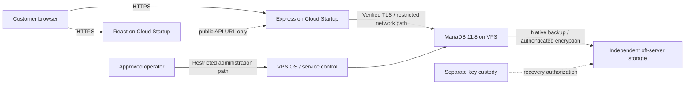

# Hostinger Cloud application and VPS database architecture

2026-11-10. Analysis only. No purchase, provisioning, production connection,
configuration change, migration, bootstrap or credential generation is authorized
or performed. Production remains **NO-GO**. This assessment does not supersede
existing migration, transport, MFA or release approvals.

## Recommendation and evidence

**Prefer Option B conditionally:** retain React/Express on Cloud Startup and place
MariaDB on a separately administered Hostinger VPS. It offers the smallest application
change while restoring verified database TLS and an application account without
TRIGGER/DDL/ledger authority. First establish a supported, sufficiently restricted
Cloud-to-VPS network path and an accountable database operator. Do not purchase a
VPS on the assumption that the two products share private networking.

Repository facts: direct mysql2 pooling, MariaDB-specific migrations, 85 ordered
migrations 000000-000084, 32 tables including the ledger, and 46 triggers. The
[336-test report](HOSTINGER_CLOUD_STARTUP_TEST_REPORT.md) is existing local evidence,
not a new test run or evidence for a VPS/network deployment. Historical SQL,
verification files and schema manifest must remain unchanged.

Operator evidence: Cloud Startup, Node24, MariaDB11.8.9, deployed artifact verified,
one Cloud database account and database-wide privilege management only. Existing
screenshots/read-only operator results show an empty Cloud database; its present
state has not been queried. The listed November10 02:02UTC backup has not been
restore-tested. No referenced project report was missing.

Public documentation was checked on 2026-11-10. Hostinger describes its VPS as
self-managed: appoint an OS/database administrator rather than assuming a managed
MariaDB service is included. [Hostinger management responsibilities](https://www.hostinger.com/support/8311982-what-is-managed-hosting-in-hostinger/)

## Proposed boundaries

The network arrow is a **proposal**, not established connectivity. TLS authenticates
the database server; database passwords authenticate clients. No client-certificate
authentication is implemented in the current pool. Firewall source identity may be
shared hosting egress, not a unique tenant. A VPS is a distinct virtual host, not a
claim of dedicated physical hardware or immunity from provider/administrator access.
HTTPS, TLS and encrypted backups do not establish disk encryption at rest.

Runtime stays separate from operator credentials. Database administrators can alter
all database protections; separate accounts reduce application compromise impact,
not DBA authority. Preserve the four-tier hierarchy, tenant query scoping, RBAC,
MFA and equal public/private review paths; infrastructure does not replace them.

## MariaDB and capacity proposal

Use MariaDB **11.8.9 for the initial parity rehearsal** on a supported Linux OS,
proposed Ubuntu24.04 LTS with the official signed MariaDB11.8 package repository.
Confirm exact package availability/security status before procurement. Do not
assume the OS default MariaDB package is 11.8 or substitute MySQL. Official packaging
supports repository selection; installation commands require a later approved plan.
[MariaDB package installation](https://mariadb.com/docs/server/server-management/install-and-upgrade-mariadb/installing-mariadb/binary-packages/installing-mariadb-deb-files)

InnoDB, utf8mb4/utf8mb4_unicode_ci, UTC sessions, strict SQL mode, enforced FK and
CHECK constraints must match rehearsal. Preserve generated PERSISTENT columns,
ENUM domains, trigger order, binary IDs, BIGINT strings, immutable records and
append-only guards. No SQL-engine conversion is proposed. Adopt reviewed security
patches within 11.8 after rehearsal, not an indefinite vulnerable version pin;
the recovery tool's exact-version restriction needs attention before such changes.

Sizing assumptions, not measured workload: pilot database <=10GB including indexes,
growth <=1GB/month, <=2 sustained API requests/second and bursts <=10, one backend
instance, no analytics warehouse or HA replica. Conditional starting candidate:
2vCPU/8GB/100GB, subject to the [cost and operations assessment](HOSTINGER_VPS_COST_AND_OPERATIONS.md).
Initially budget roughly 3-4GB for InnoDB buffer pool, then measure. Connection
buffers, OS, backup compression/encryption and temporary queries need remaining RAM.
Keep application pool default5 initially; total pools across processes plus operators,
backup and headroom must fit a measured server connection/memory budget. Do not
derive max_connections from merchant count alone.

Disk must cover data/indexes, temporary DDL space, binlogs if enabled, encrypted
staging and OS logs; alert before 75% use as a proposed threshold. Off-server copies
must not depend on surviving local disk. Hostinger documents no default VPS disk
encryption at rest. Require a separately reviewed encrypted-volume/database design
and key-unlock/reboot recovery rehearsal, or an explicit accepted at-rest risk;
TLS alone does not close it. [Provider encryption limitations](https://www.hostinger.com/support/1583232-how-to-back-up-or-restore-a-vps-at-hostinger/)

## Application and artifact impact

Standard verified-TLS connections and the strict operator support a remote DNS
endpoint with valid trust material. No core business/SQL change is justified by
changing provider. However, final review found an operator-CLI empty-CA gap: fix
and test pre-connection refusal before remote operator use. See the network report.
Other work is reviewed environment, certificates, identities, networking, Linux
recovery tooling and deployment evidence.

| Files / artifact | Required treatment in a later implementation |
| --- | --- |
| backend/src/config/env.ts, database-transport.ts, tls.ts | Preserve validation; select required TLS with approved CA and DNS identity. |
| backend/src/db/pool.ts, server.ts, app.ts | Preserve verification, no fallback, prompt listen and separate readiness; measure remote latency. |
| backend/src/migrations/{operator,operator-cli,privileges,runner,schema}.ts | Preserve strict profiles/target/approvals; fix operator-cli empty-CA handling before connection, with negative tests; no Cloud exception. |
| backend/src/setup/{cli,bootstrap}.ts | Rehearse metadata visibility, controlled bootstrap authority and first-login MFA. |
| backend/scripts/recovery/{cli,utility}.mjs | Separate approved Linux/production/TLS recovery implementation or reviewed native DBA workflow is needed. Existing utility is disposable Windows/local only. |
| backend/.env.example and deployment/runbooks | Document remote requirements without actual secrets. Frontend VITE_API_URL stays the API URL. |
| backend/test/migration-safety.integration.mjs, cloud-startup.integration.mjs, recovery and TLS tests | Retain existing regressions; add/rehearse Linux TLS, separate-definer recovery and network failures in isolated systems. |
| backend/migrations/* and backend/docs/schema-manifest.json | No changes authorized; preserve all historical bytes/checksums. |

See [network](HOSTINGER_VPS_NETWORK_SECURITY.md), [privileges](HOSTINGER_VPS_DATABASE_PRIVILEGES.md),
[migration/recovery](HOSTINGER_VPS_MIGRATION_AND_RECOVERY.md) and the consolidated
[production decision](HOSTINGER_VPS_PRODUCTION_READINESS.md). None of this assessment
authorizes implementing the proposal.
